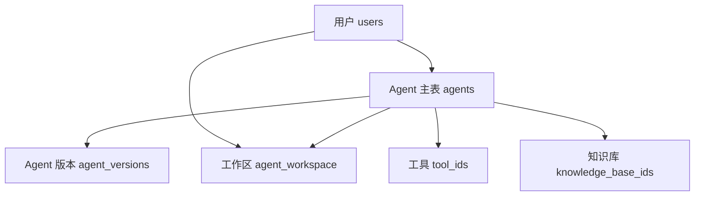

# 第 11 课：Agent 数据模型（小白版）

## 这节课要解决什么问题

从这一课开始，我们正式进入 AgentX 的核心：

```text
一个 Agent 到底是什么？
```

如果从用户角度看，Agent 就是一个可以聊天、会使用工具、能连接知识库的 AI 助手。

但从程序角度看，Agent 不是一个“神秘的机器人”，而是一组被保存起来的数据：

- 它叫什么名字
- 它长什么头像
- 它负责什么事情
- 它应该用什么语气回答
- 它开场说什么
- 它能不能调用工具
- 它能不能读取知识库
- 它属于哪个用户
- 它是否已经发布
- 它在工作区里使用哪个模型配置

这一课的目标，就是把 Agent 拆开看清楚。

## 本课学习目标

学完本课后，你应该能回答：

1. Agent 在数据库里主要保存在哪张表？
2. `AgentEntity` 是什么？
3. Agent 的名称、描述、头像、系统提示词分别对应什么字段？
4. `systemPrompt` 和 `welcomeMessage` 有什么区别？
5. `toolIds` 是什么？
6. `knowledgeBaseIds` 是什么？
7. Agent 为什么要有 `userId`？
8. 模型配置为什么放在 `agent_workspace` 里？

## 先用“员工档案”理解 Agent

你可以先把 Agent 理解成一名员工。

公司给每个员工建立一份档案：

| 档案内容 | 对应 Agent 字段 |
| --- | --- |
| 员工姓名 | `name` |
| 员工照片 | `avatar` |
| 岗位说明 | `description` |
| 工作守则 | `systemPrompt` |
| 接待开场白 | `welcomeMessage` |
| 可使用的办公工具 | `toolIds` |
| 可查阅的资料库 | `knowledgeBaseIds` |
| 所属老板 | `userId` |
| 是否在岗 | `enabled` |

所以 Agent 不是凭空存在的。

它是一份“AI 助手档案”。

用户创建 Agent，本质上就是往系统里新增一份助手档案。

## Agent 数据保存在哪里

AgentX 中 Agent 的主表是：

```text
agents
```

你可以在这个 SQL 文件里看到它：

```text
E:\agentx\AgentX\docs\sql\01_init.sql
```

表结构里有这些核心字段：

| 数据库字段 | Java 字段 | 小白解释 |
| --- | --- | --- |
| `id` | `id` | Agent 的唯一编号 |
| `name` | `name` | Agent 名称 |
| `avatar` | `avatar` | Agent 头像地址 |
| `description` | `description` | Agent 说明 |
| `system_prompt` | `systemPrompt` | 系统提示词 |
| `welcome_message` | `welcomeMessage` | 欢迎语 |
| `tool_ids` | `toolIds` | 可用工具 ID 列表 |
| `knowledge_base_ids` | `knowledgeBaseIds` | 关联知识库 ID 列表 |
| `published_version` | `publishedVersion` | 当前发布版本 |
| `enabled` | `enabled` | 是否启用 |
| `user_id` | `userId` | 创建者用户 ID |
| `tool_preset_params` | `toolPresetParams` | 工具预设参数 |
| `multi_modal` | `multiModal` | 是否支持多模态 |
| `created_at` | `createdAt` | 创建时间 |
| `updated_at` | `updatedAt` | 更新时间 |
| `deleted_at` | `deletedAt` | 删除时间 |

## Java 里的 AgentEntity

数据库表是给数据库看的。

Java 代码里也需要一个对象来代表 Agent。

这个对象就是：

```text
E:\agentx\AgentX\AgentX\src\main\java\org\xhy\domain\agent\model\AgentEntity.java
```

你可以把 `AgentEntity` 理解成：

```text
Java 世界里的 Agent 档案表。
```

代码里有一句很重要：

```java
@TableName(value = "agents", autoResultMap = true)
public class AgentEntity extends BaseEntity {
}
```

意思是：

```text
这个 Java 类对应数据库里的 agents 表。
```

再看字段：

```java
@TableField("name")
private String name;

@TableField("system_prompt")
private String systemPrompt;

@TableField("welcome_message")
private String welcomeMessage;
```

这说明：

```text
Java 字段 systemPrompt 对应数据库字段 system_prompt。
Java 字段 welcomeMessage 对应数据库字段 welcome_message。
```

数据库喜欢用下划线命名，Java 喜欢用驼峰命名。

| 数据库写法 | Java 写法 |
| --- | --- |
| `system_prompt` | `systemPrompt` |
| `welcome_message` | `welcomeMessage` |
| `knowledge_base_ids` | `knowledgeBaseIds` |

## Agent 的基本信息

Agent 的基本信息主要有：

```text
name
avatar
description
```

它们对应用户能直接看到的内容。

例如你创建一个“英语口语陪练”：

| 字段 | 例子 |
| --- | --- |
| `name` | 英语口语陪练 |
| `avatar` | 一个头像图片地址 |
| `description` | 帮助用户练习英语对话 |

这些信息主要用于展示。

## systemPrompt：Agent 的“工作守则”

`systemPrompt` 是 Agent 最重要的字段之一。

你可以把它理解成：

```text
写给 AI 的内部工作说明书。
```

例如：

```text
你是一名英语口语老师。
请用简单英语和用户对话。
当用户说错语法时，先鼓励，再指出错误。
不要一次解释太多。
```

用户不一定直接看到这段话，但模型会根据它来决定怎么回答。

所以：

```text
systemPrompt 决定 Agent 的角色、边界、语气和任务方式。
```

## welcomeMessage：Agent 的“开场白”

`welcomeMessage` 是用户进入对话后看到的第一句话。

例如：

```text
你好，我是你的英语口语陪练。今天想练习点餐、面试，还是日常闲聊？
```

它和 `systemPrompt` 的区别是：

| 字段 | 给谁看 | 作用 |
| --- | --- | --- |
| `systemPrompt` | 主要给模型看 | 规定 Agent 怎么工作 |
| `welcomeMessage` | 给用户看 | 对用户打招呼，引导开始聊天 |

一个简单记法：

```text
systemPrompt 是员工手册。
welcomeMessage 是前台问候语。
```

## toolIds：Agent 能用哪些工具

有些 Agent 不只是聊天，还可以做事。

比如：

- 查询天气
- 调用搜索
- 读取文件
- 调用外部 API
- 执行某个 MCP 工具

这些能力在系统里通常会被抽象成“工具”。

Agent 的 `toolIds` 保存的是：

```text
这个 Agent 被允许使用哪些工具。
```

它是一个列表。

可以理解成：

```text
员工工牌上写着他可以进入哪些工具间。
```

如果某个工具 ID 不在 `toolIds` 里，Agent 理论上就不应该使用它。

## knowledgeBaseIds：Agent 能查哪些资料

知识库可以理解成：

```text
专门给 Agent 查阅的资料文件夹。
```

比如你上传了：

- 公司制度文档
- 产品说明书
- 客服常见问题
- 教程资料

Agent 如果关联了这些知识库，就可以在回答时参考这些资料。

`knowledgeBaseIds` 保存的是：

```text
这个 Agent 关联了哪些知识库。
```

它也是一个列表。

一个客服 Agent 可能关联“客服知识库”。

一个财务 Agent 可能关联“报销制度知识库”。

## userId：Agent 属于谁

`userId` 非常重要。

它表示：

```text
这个 Agent 是哪个用户创建的。
```

为什么要有这个字段？

因为系统里会有很多用户，每个用户都可以创建自己的 Agent。

如果没有 `userId`，系统就分不清：

- 哪些 Agent 是你的
- 哪些 Agent 是别人的
- 你有没有权限修改这个 Agent

所以 `userId` 是权限判断的基础。

在后面的创建和编辑流程里，你会看到很多查询条件都会带上：

```text
agentId + userId
```

这就像银行取钱时不能只说卡号，还要证明这张卡是你的。

## enabled：Agent 是否启用

`enabled` 表示 Agent 当前是否可用。

| 值 | 含义 |
| --- | --- |
| `true` | 启用，可以使用 |
| `false` | 禁用，不应该继续使用 |

在 `AgentEntity` 里有两个方法：

```java
public void enable()
public void disable()
```

它们就像开关。

启用时把 `enabled` 设为 `true`。

禁用时把 `enabled` 设为 `false`。

## publishedVersion：当前发布版本

AgentX 里 Agent 有“草稿”和“发布版本”的概念。

第 13 课会专门讲版本管理，这里先知道：

```text
publishedVersion 记录当前公开发布的是哪个版本。
```

打个比方：

你正在编辑一份文档。

本地可以继续改，但对外展示的可能还是上一个正式版本。

`publishedVersion` 就是指向那个正式版本的编号。

## 模型配置在哪里

你可能会问：

```text
Agent 不是还要配置模型吗？
比如用哪个大模型、temperature 是多少？
```

这个项目里，模型配置主要由 `LLMModelConfig` 表示：

```text
E:\agentx\AgentX\AgentX\src\main\java\org\xhy\domain\agent\model\LLMModelConfig.java
```

里面有这些字段：

| 字段 | 小白解释 |
| --- | --- |
| `modelId` | 使用哪个模型 |
| `temperature` | 回答更稳定还是更有创造性 |
| `topP` | 控制输出多样性 |
| `topK` | 控制候选范围 |
| `maxTokens` | 最多使用多少 Token |
| `strategyType` | 上下文超长时怎么处理 |
| `reserveRatio` | 预留多少上下文空间 |
| `summaryThreshold` | 多少消息后触发摘要 |

但注意：

```text
这些配置不是直接放在 agents 主表里。
```

它们放在工作区表：

```text
agent_workspace
```

对应 Java 类：

```text
E:\agentx\AgentX\AgentX\src\main\java\org\xhy\domain\agent\model\AgentWorkspaceEntity.java
```

这里有一个字段：

```java
private LLMModelConfig llmModelConfig;
```

## 为什么模型配置放在工作区

你可以这样理解：

```text
Agent 主表保存“这个助手是谁”。
Agent 工作区保存“某个用户怎么使用这个助手”。
```

比如一个公开的 Agent 可以被很多用户添加到自己的工作区。

不同用户可能希望使用不同的模型配置：

| 用户 | 同一个 Agent | 模型配置 |
| --- | --- | --- |
| 用户 A | 英语老师 Agent | 更稳定，少发散 |
| 用户 B | 英语老师 Agent | 更活泼，更有创造力 |

所以模型配置放在 `agent_workspace` 更灵活。

## Agent 相关数据表之间的关系

先看一个简化图：



这张图可以这样读：

1. 一个用户可以创建多个 Agent。
2. 一个 Agent 可以有多个版本。
3. 用户可以把 Agent 加入自己的工作区。
4. Agent 可以关联多个工具。
5. Agent 可以关联多个知识库。

## 创建 Agent 时会保存哪些数据

创建请求对应这个文件：

```text
E:\agentx\AgentX\AgentX\src\main\java\org\xhy\interfaces\dto\agent\request\CreateAgentRequest.java
```

里面包括：

```text
name
description
avatar
systemPrompt
welcomeMessage
toolIds
knowledgeBaseIds
toolPresetParams
multiModal
```

这些就是用户创建 Agent 时可以提交的信息。

系统会把这些信息转换成 `AgentEntity`，再保存到数据库。

## 本课小结

这一课你要记住一句话：

```text
Agent 本质上是一份 AI 助手档案。
```

这份档案的核心信息保存在 `agents` 表里。

Java 代码里用 `AgentEntity` 表示这份档案。

其中：

- `name`、`avatar`、`description` 决定展示信息
- `systemPrompt` 决定 Agent 怎么工作
- `welcomeMessage` 决定用户打开时看到什么
- `toolIds` 决定 Agent 能用哪些工具
- `knowledgeBaseIds` 决定 Agent 能查哪些资料
- `userId` 决定 Agent 属于谁
- `enabled` 决定 Agent 是否可用
- `publishedVersion` 指向当前正式版本
- `LLMModelConfig` 描述模型配置，主要放在 `agent_workspace`

## 本课源码阅读路线

建议按这个顺序看源码：

1. `E:\agentx\AgentX\docs\sql\01_init.sql`
2. `E:\agentx\AgentX\AgentX\src\main\java\org\xhy\domain\agent\model\AgentEntity.java`
3. `E:\agentx\AgentX\AgentX\src\main\java\org\xhy\domain\agent\model\AgentWorkspaceEntity.java`
4. `E:\agentx\AgentX\AgentX\src\main\java\org\xhy\domain\agent\model\LLMModelConfig.java`
5. `E:\agentx\AgentX\AgentX\src\main\java\org\xhy\interfaces\dto\agent\request\CreateAgentRequest.java`
6. `E:\agentx\AgentX\AgentX\src\main\java\org\xhy\application\agent\dto\AgentDTO.java`

## 课后练习

### 练习 1：用自己的话解释 Agent

请用一句话回答：

```text
Agent 在系统里到底是什么？
```

参考答案：

```text
Agent 是一份保存了名称、提示词、工具、知识库、归属用户等信息的 AI 助手档案。
```

### 练习 2：区分两个提示词字段

请区分：

```text
systemPrompt 和 welcomeMessage 有什么不同？
```

参考答案：

```text
systemPrompt 是给模型看的工作规则。
welcomeMessage 是给用户看的开场白。
```

### 练习 3：找字段

打开 `AgentEntity.java`，找出这 5 个字段：

- `name`
- `systemPrompt`
- `welcomeMessage`
- `toolIds`
- `knowledgeBaseIds`

然后回到 `01_init.sql`，找出它们在数据库里的对应字段。

## 下一课预告

下一课我们会追踪完整流程：

```text
用户在页面点击“创建 Agent”之后，后端代码到底怎么一步步保存它？
```

你会看到：

- Controller 如何接收请求
- AppService 如何协调业务
- Assembler 如何转换数据
- DomainService 如何保存数据库
- 权限校验为什么总是和 `userId` 有关
