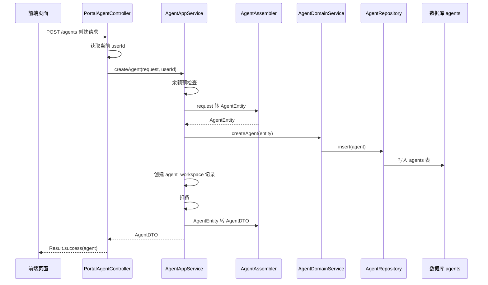
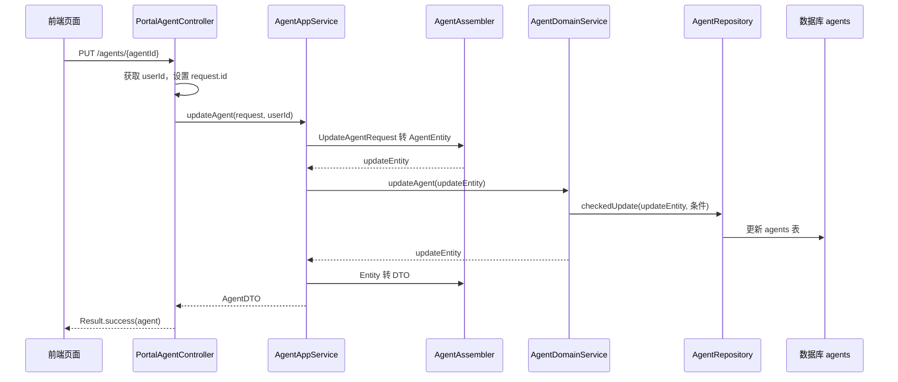

# 第 12 课：Agent 创建与编辑流程（小白版）

## 这节课要解决什么问题

上一课我们知道了：

```text
Agent 本质上是一份 AI 助手档案。
```

这一课继续往下问：

```text
用户在页面上创建或编辑 Agent 后，这份档案是怎么被保存起来的？
```

你会看到一条完整链路：

```text
页面提交 -> Controller 接收 -> AppService 协调 -> Assembler 转换 -> DomainService 落库 -> DTO 返回
```

这条链路是理解 AgentX 后端代码的关键。

## 本课学习目标

学完本课后，你应该能回答：

1. `PortalAgentController` 负责什么？
2. `CreateAgentRequest` 是什么？
3. `UpdateAgentRequest` 是什么？
4. `AgentAppService` 为什么叫应用服务？
5. `AgentAssembler` 负责什么？
6. `AgentDomainService` 负责什么？
7. 创建 Agent 时为什么还要创建工作区记录？
8. 更新 Agent 时为什么要同时检查 `agentId` 和 `userId`？

## 先用“办会员卡”理解创建流程

假设你去健身房办会员卡。

流程大概是：

1. 你在表格上填写姓名、手机号、套餐。
2. 前台接收你的表格。
3. 前台检查你有没有填姓名。
4. 工作人员把表格内容录入系统。
5. 系统生成会员编号。
6. 前台把办好的会员卡交给你。

创建 Agent 也很像：

1. 用户在页面填写 Agent 名称、描述、提示词。
2. 前端把表单提交给后端。
3. Controller 接收请求。
4. AppService 协调整个创建过程。
5. Assembler 把请求转换成 Entity。
6. DomainService 保存到数据库。
7. 后端返回 AgentDTO 给前端。

## 创建 Agent 的源码入口

创建 Agent 的入口在：

```text
E:\agentx\AgentX\AgentX\src\main\java\org\xhy\interfaces\api\portal\agent\PortalAgentController.java
```

核心代码是：

```java
@PostMapping
public Result<AgentDTO> createAgent(@RequestBody @Validated CreateAgentRequest request) {
    String userId = UserContext.getCurrentUserId();
    AgentDTO agent = agentAppService.createAgent(request, userId);
    return Result.success(agent);
}
```

这段代码做了三件事：

| 代码 | 小白解释 |
| --- | --- |
| `@PostMapping` | 接收“创建”请求 |
| `CreateAgentRequest request` | 接收用户填写的表单 |
| `UserContext.getCurrentUserId()` | 找到当前登录用户是谁 |
| `agentAppService.createAgent(...)` | 把真正的创建工作交给应用服务 |
| `Result.success(agent)` | 把创建结果返回给前端 |

## 什么是 Controller

Controller 可以理解成：

```text
系统门口的接待员。
```

它负责：

- 接收前端请求
- 读取路径参数
- 读取请求体
- 获取当前用户
- 调用后面的服务
- 把结果包装成统一格式返回

但它不应该负责太复杂的业务。

比如创建 Agent 要不要扣费、要不要创建工作区、要怎么保存数据库，这些都不应该塞在 Controller 里。

这些事情交给 `AgentAppService`。

## CreateAgentRequest：用户填写的创建表单

创建请求对象在：

```text
E:\agentx\AgentX\AgentX\src\main\java\org\xhy\interfaces\dto\agent\request\CreateAgentRequest.java
```

它像一张表单：

```java
public class CreateAgentRequest {
    @NotBlank(message = "助理名称不可为空")
    private String name;
    private String description;
    private String avatar;
    private String systemPrompt;
    private String welcomeMessage;
    private List<String> toolIds;
    private List<String> knowledgeBaseIds;
    private Map<String, Map<String, Map<String, String>>> toolPresetParams;
    private Boolean multiModal;
}
```

最重要的是：

```java
@NotBlank(message = "助理名称不可为空")
private String name;
```

意思是：

```text
创建 Agent 时，名称不能为空。
```

这就是最基础的参数校验。

## 创建流程总览

先看一张完整流程图：



先不用害怕这张图。

你只要记住它是一条传送带：

```text
请求进来，一层一层处理，最后保存到数据库，再把结果返回出去。
```

## AgentAppService：流程总指挥

应用服务在：

```text
E:\agentx\AgentX\AgentX\src\main\java\org\xhy\application\agent\service\AgentAppService.java
```

创建 Agent 的方法是：

```java
@Transactional
public AgentDTO createAgent(CreateAgentRequest request, String userId) {
}
```

`AgentAppService` 做的事情比 Controller 多：

1. 记录创建日志。
2. 创建计费上下文。
3. 检查账户余额是否足够。
4. 把请求转换成 `AgentEntity`。
5. 调用领域服务保存 Agent。
6. 创建工作区记录。
7. 创建成功后扣费。
8. 把 Entity 转成 DTO 返回。

你可以把它理解成：

```text
创建 Agent 这件事的项目经理。
```

它不亲自把数据写进数据库，但它知道整个流程应该怎么走。

## 为什么创建前要检查余额

创建方法里有一段逻辑：

```text
余额预检查
```

这说明在 AgentX 里，创建 Agent 可能是一个会计费的行为。

所以系统会先问：

```text
这个用户余额够不够？
```

如果余额不够，就抛出异常：

```text
账户余额不足，无法创建Agent。请先充值后再试。
```

这就像打印店复印资料前先确认你卡里有没有余额。

## AgentAssembler：表单和档案之间的转换器

转换器在：

```text
E:\agentx\AgentX\AgentX\src\main\java\org\xhy\application\agent\assembler\AgentAssembler.java
```

创建时会调用：

```java
AgentEntity entity = AgentAssembler.toEntity(request, userId);
```

意思是：

```text
把用户提交的 CreateAgentRequest 转成数据库能保存的 AgentEntity。
```

你可以把它理解成：

```text
把用户填的表单，整理成系统内部的标准档案。
```

例如：

| Request 字段 | Entity 字段 |
| --- | --- |
| `request.getName()` | `entity.setName(...)` |
| `request.getDescription()` | `entity.setDescription(...)` |
| `request.getSystemPrompt()` | `entity.setSystemPrompt(...)` |
| `request.getWelcomeMessage()` | `entity.setWelcomeMessage(...)` |
| `request.getToolIds()` | `entity.setToolIds(...)` |
| `request.getKnowledgeBaseIds()` | `entity.setKnowledgeBaseIds(...)` |
| `userId` | `entity.setUserId(...)` |

## Entity、DTO、Request 分别是什么

这一组词很容易把新手绕晕。

先用最简单的话理解：

| 名称 | 小白解释 | 用在哪里 |
| --- | --- | --- |
| Request | 用户提交的表单 | 前端到后端 |
| Entity | 数据库里的正式档案 | 后端和数据库 |
| DTO | 返回给前端看的结果 | 后端到前端 |

用健身房办卡比喻：

| 编程概念 | 办卡场景 |
| --- | --- |
| Request | 你填写的申请表 |
| Entity | 系统里的会员档案 |
| DTO | 打印给你的会员卡信息 |

为什么要分这么多对象？

因为它们职责不同。

用户提交的内容，不一定等于数据库完整字段。

数据库保存的内容，也不一定全部返回给前端。

## AgentDomainService：真正处理领域规则

领域服务在：

```text
E:\agentx\AgentX\AgentX\src\main\java\org\xhy\domain\agent\service\AgentDomainService.java
```

创建方法很短：

```java
public AgentEntity createAgent(AgentEntity agent) {
    agentRepository.insert(agent);
    return agent;
}
```

它做的事很直接：

```text
把 AgentEntity 插入数据库。
```

这里用到了：

```text
AgentRepository
```

Repository 是数据库操作入口。

你可以把它理解成：

```text
专门负责和数据库打交道的工作人员。
```

## 为什么创建 Agent 时还要创建工作区

在 `AgentAppService.createAgent` 里，保存 Agent 后还有一段：

```java
AgentWorkspaceEntity agentWorkspaceEntity = new AgentWorkspaceEntity(
    agent.getId(),
    userId,
    new LLMModelConfig()
);
agentWorkspaceDomainService.save(agentWorkspaceEntity);
```

意思是：

```text
创建 Agent 后，同时把它加入当前用户的工作区，并创建默认模型配置。
```

上一课讲过：

```text
Agent 主表保存“这个助手是谁”。
工作区保存“某个用户怎么使用这个助手”。
```

所以创建 Agent 后，系统顺手创建一条工作区记录。

这就像你办了一张会员卡后，健身房顺便给你开通了一个默认训练空间。

## 创建 Agent 的完整数据变化

创建成功后，至少会发生两类数据变化：

| 表 | 保存什么 |
| --- | --- |
| `agents` | Agent 的基础档案 |
| `agent_workspace` | 用户工作区里的模型配置 |

如果计费成功，还会产生计费相关记录。

本课先关注 Agent 主线，计费系统后面单独学。

## 编辑 Agent 的入口

更新 Agent 的入口也在：

```text
E:\agentx\AgentX\AgentX\src\main\java\org\xhy\interfaces\api\portal\agent\PortalAgentController.java
```

核心代码：

```java
@PutMapping("/{agentId}")
public Result<AgentDTO> updateAgent(
        @PathVariable String agentId,
        @RequestBody @Validated UpdateAgentRequest request) {
    String userId = UserContext.getCurrentUserId();
    request.setId(agentId);
    return Result.success(agentAppService.updateAgent(request, userId));
}
```

这里有几个重点：

| 代码 | 小白解释 |
| --- | --- |
| `@PutMapping("/{agentId}")` | 修改某个指定 Agent |
| `@PathVariable String agentId` | 从网址里拿到 Agent ID |
| `UpdateAgentRequest request` | 接收用户提交的新内容 |
| `request.setId(agentId)` | 把网址里的 ID 放进请求对象 |
| `UserContext.getCurrentUserId()` | 获取当前登录用户 |

## UpdateAgentRequest：用户填写的编辑表单

文件位置：

```text
E:\agentx\AgentX\AgentX\src\main\java\org\xhy\interfaces\dto\agent\request\UpdateAgentRequest.java
```

它包含：

```text
id
name
avatar
description
enabled
systemPrompt
welcomeMessage
modelConfig
toolIds
knowledgeBaseIds
toolPresetParams
multiModal
```

可以看到，编辑请求比创建请求多了一些字段。

比如：

- `id`：要改哪个 Agent
- `enabled`：是否启用
- `modelConfig`：模型配置

不过在当前创建和编辑主线里，`AgentAssembler.toEntity` 会先把请求复制成 `AgentEntity`，再交给领域服务更新。

## 编辑流程总览

编辑流程可以简化成：



## 更新时为什么要检查 agentId 和 userId

`AgentDomainService.updateAgent` 里有一段非常关键：

```java
LambdaUpdateWrapper<AgentEntity> wrapper = Wrappers.<AgentEntity>lambdaUpdate()
        .eq(AgentEntity::getId, updateEntity.getId())
        .eq(AgentEntity::getUserId, updateEntity.getUserId());
agentRepository.checkedUpdate(updateEntity, wrapper);
```

意思是：

```text
只更新“这个用户自己的这个 Agent”。
```

不是只看 `agentId`。

也不是只看 `userId`。

而是两个条件都要满足：

```text
Agent ID 对得上。
当前用户也必须是它的创建者。
```

这就是权限保护。

否则可能发生严重问题：

```text
用户 A 猜到了用户 B 的 Agent ID，然后修改了用户 B 的 Agent。
```

所以系统必须用 `agentId + userId` 双重确认。

## checkedUpdate 是什么

你会看到这里不是普通的 `update`，而是：

```text
checkedUpdate
```

从命名上看，它大概率表示：

```text
带检查的更新。
```

也就是说，如果没有任何数据被更新，系统可以认为：

- 这个 Agent 不存在
- 或者这个 Agent 不属于当前用户
- 或者更新失败

这种写法比“悄悄失败”更安全。

## 创建和编辑的区别

| 对比项 | 创建 Agent | 编辑 Agent |
| --- | --- | --- |
| HTTP 方法 | `POST /agents` | `PUT /agents/{agentId}` |
| 请求对象 | `CreateAgentRequest` | `UpdateAgentRequest` |
| 是否已有 ID | 没有，数据库生成 | 有，从路径里取 |
| 是否插入新数据 | 是 | 否，更新旧数据 |
| 是否创建工作区 | 是 | 通常不是这条主线 |
| 是否检查归属用户 | 创建时绑定用户 | 更新时用 `agentId + userId` 校验 |

## 创建和编辑都返回 AgentDTO

创建成功后返回：

```text
AgentDTO
```

编辑成功后也返回：

```text
AgentDTO
```

DTO 文件在：

```text
E:\agentx\AgentX\AgentX\src\main\java\org\xhy\application\agent\dto\AgentDTO.java
```

它是给前端看的结果对象。

你可以理解成：

```text
后端办完事后，给前端的一张回执。
```

前端拿到这个 DTO 后，就可以刷新页面上的 Agent 名称、描述、提示词等信息。

## 一句话记住整条链路

请记住这句话：

```text
Controller 接请求，AppService 排流程，Assembler 做转换，DomainService 管规则，Repository 存数据库，DTO 回前端。
```

这是很多后端项目都会用到的分层思想。

学会这条链路后，你再看其他功能，比如工具、知识库、用户设置，也会更容易。

## 本课源码阅读路线

建议按这个顺序打开源码：

1. `E:\agentx\AgentX\AgentX\src\main\java\org\xhy\interfaces\api\portal\agent\PortalAgentController.java`
2. `E:\agentx\AgentX\AgentX\src\main\java\org\xhy\interfaces\dto\agent\request\CreateAgentRequest.java`
3. `E:\agentx\AgentX\AgentX\src\main\java\org\xhy\interfaces\dto\agent\request\UpdateAgentRequest.java`
4. `E:\agentx\AgentX\AgentX\src\main\java\org\xhy\application\agent\service\AgentAppService.java`
5. `E:\agentx\AgentX\AgentX\src\main\java\org\xhy\application\agent\assembler\AgentAssembler.java`
6. `E:\agentx\AgentX\AgentX\src\main\java\org\xhy\domain\agent\service\AgentDomainService.java`
7. `E:\agentx\AgentX\AgentX\src\main\java\org\xhy\domain\agent\repository\AgentRepository.java`
8. `E:\agentx\AgentX\AgentX\src\main\java\org\xhy\application\agent\dto\AgentDTO.java`

## 课后练习

### 练习 1：画出创建流程

请用自己的话补全：

```text
前端页面提交创建请求
-> ________ 接收请求
-> ________ 协调整个创建流程
-> ________ 把 Request 转成 Entity
-> ________ 保存到数据库
-> 返回 ________
```

参考答案：

```text
PortalAgentController
AgentAppService
AgentAssembler
AgentDomainService / AgentRepository
AgentDTO
```

### 练习 2：解释 Request、Entity、DTO

请分别解释：

```text
Request 是什么？
Entity 是什么？
DTO 是什么？
```

参考答案：

```text
Request 是前端提交的表单。
Entity 是后端内部用于保存数据库的数据对象。
DTO 是后端返回给前端看的结果对象。
```

### 练习 3：找权限校验

打开：

```text
E:\agentx\AgentX\AgentX\src\main\java\org\xhy\domain\agent\service\AgentDomainService.java
```

找到 `updateAgent` 方法。

观察这两个条件：

```text
AgentEntity::getId
AgentEntity::getUserId
```

然后回答：

```text
为什么更新 Agent 时不能只检查 agentId？
```

参考答案：

```text
因为只检查 agentId 可能让其他用户修改不属于自己的 Agent。
必须同时检查 userId，确认当前用户就是这个 Agent 的创建者。
```

## 常见困惑

### 困惑 1：为什么 Controller 不直接保存数据库？

因为 Controller 的职责是接收请求和返回结果。

如果把所有业务都写在 Controller 里，文件会越来越乱，也很难测试。

### 困惑 2：为什么要有 Assembler？

因为 Request、Entity、DTO 长得像，但职责不同。

Assembler 专门负责在它们之间做转换，代码会更清楚。

### 困惑 3：为什么 AppService 和 DomainService 都叫 Service？

它们关注点不同。

| 名称 | 重点 |
| --- | --- |
| AppService | 编排一个完整用例流程 |
| DomainService | 执行领域规则和核心数据操作 |

创建 Agent 时，AppService 关心余额、工作区、扣费、返回结果。

DomainService 关心 Agent 怎么保存、怎么更新、怎么查询。

## 本课小结

这一课你需要掌握：

- 创建 Agent 的入口是 `POST /agents`
- 编辑 Agent 的入口是 `PUT /agents/{agentId}`
- `PortalAgentController` 负责接收请求
- `CreateAgentRequest` 和 `UpdateAgentRequest` 是用户提交的表单
- `AgentAppService` 负责编排完整流程
- `AgentAssembler` 负责对象转换
- `AgentDomainService` 负责保存和更新 Agent
- `AgentRepository` 负责数据库操作
- `AgentDTO` 是返回给前端的结果
- 更新 Agent 时必须用 `agentId + userId` 做权限保护

## 下一课预告

下一课我们会学习：

```text
Agent 版本管理。
```

也就是：

- 为什么 Agent 需要版本
- 草稿和发布版有什么区别
- `agent_versions` 表保存了什么
- 管理员审核发布时发生了什么
