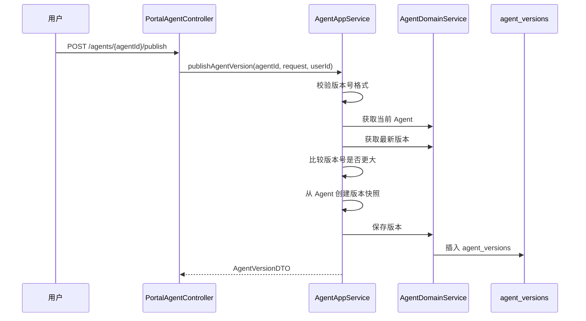

# 第 13 课：Agent 版本管理（小白版）

## 这节课要解决什么问题

前面我们已经知道：

```text
Agent 是一份 AI 助手档案。
```

这份档案可以不断被编辑。

比如你今天改了提示词，明天换了头像，后天又加了工具。

但问题来了：

```text
如果 Agent 已经发布给别人使用了，能不能一边改一边影响所有用户？
```

通常不应该。

所以 AgentX 引入了“版本”。

你可以把版本理解成：

```text
某一刻正式保存下来的 Agent 快照。
```

## 本课学习目标

学完本课后，你应该能回答：

1. 为什么 Agent 需要版本？
2. `agents` 表和 `agent_versions` 表有什么区别？
3. 什么是草稿？
4. 什么是发布版本？
5. 什么是版本快照？
6. 版本号 `1.0.0` 是什么意思？
7. `changeLog` 是什么？
8. 发布 Agent 版本时，源码怎么走？

## 先用“写文章”理解版本

假设你在写一篇公众号文章。

你电脑里有一个正在修改的文档：

```text
我的文章.docx
```

你可以随时改标题、改正文、加图片。

这就是“草稿”。

但你点了“发布”之后，读者看到的是发布时那一刻的内容。

之后你继续改草稿，读者不会立刻看到你的新草稿。

只有你再次发布一个新版本，读者才会看到新内容。

Agent 也是一样：

| 场景 | AgentX 里的概念 |
| --- | --- |
| 正在编辑的 Agent | `agents` 表里的当前配置 |
| 点击发布那一刻的 Agent | `agent_versions` 表里的版本快照 |
| 版本编号 | `versionNumber` |
| 这次改了什么 | `changeLog` |
| 管理员是否通过 | `publishStatus` |

## AgentEntity 和 AgentVersionEntity 的区别

上一课我们看过 `AgentEntity`：

```text
E:\agentx\AgentX\AgentX\src\main\java\org\xhy\domain\agent\model\AgentEntity.java
```

这一课要看 `AgentVersionEntity`：

```text
E:\agentx\AgentX\AgentX\src\main\java\org\xhy\domain\agent\model\AgentVersionEntity.java
```

它们的区别可以这样理解：

| 类 | 对应表 | 小白解释 |
| --- | --- | --- |
| `AgentEntity` | `agents` | 当前正在编辑的 Agent 档案 |
| `AgentVersionEntity` | `agent_versions` | 某次发布时保存下来的 Agent 快照 |

一句话记忆：

```text
AgentEntity 是活文档，AgentVersionEntity 是拍照存档。
```

## agent_versions 表保存什么

数据库表在：

```text
E:\agentx\AgentX\docs\sql\01_init.sql
```

核心字段：

| 数据库字段 | Java 字段 | 小白解释 |
| --- | --- | --- |
| `id` | `id` | 版本自己的编号 |
| `agent_id` | `agentId` | 属于哪个 Agent |
| `name` | `name` | 发布时的 Agent 名称 |
| `avatar` | `avatar` | 发布时的头像 |
| `description` | `description` | 发布时的描述 |
| `version_number` | `versionNumber` | 版本号 |
| `system_prompt` | `systemPrompt` | 发布时的系统提示词 |
| `welcome_message` | `welcomeMessage` | 发布时的欢迎语 |
| `tool_ids` | `toolIds` | 发布时绑定的工具 |
| `knowledge_base_ids` | `knowledgeBaseIds` | 发布时绑定的知识库 |
| `change_log` | `changeLog` | 版本更新说明 |
| `publish_status` | `publishStatus` | 发布审核状态 |
| `reject_reason` | `rejectReason` | 被拒绝原因 |
| `review_time` | `reviewTime` | 审核时间 |
| `published_at` | `publishedAt` | 发布时间 |
| `user_id` | `userId` | 创建者 |

你会发现它保存了很多和 `agents` 表相似的字段。

这是故意的。

因为版本要保存“当时的样子”。

如果只保存一个 `agent_id`，以后 Agent 草稿变了，旧版本就说不清当时长什么样了。

## 什么是版本快照

快照就是：

```text
把某一刻的状态完整复制一份保存下来。
```

比如你给白板拍照。

拍完之后，白板可以继续擦掉重写。

但照片里还是保留了拍照那一刻的内容。

Agent 发布版本也是这样：

```text
发布时，把 Agent 当前的名称、描述、提示词、工具、知识库等复制到 agent_versions 表。
```

以后你继续编辑 `agents` 表，不会直接改变已经生成的 `agent_versions` 快照。

## 发布版本的入口

用户发布 Agent 版本的接口在：

```text
E:\agentx\AgentX\AgentX\src\main\java\org\xhy\interfaces\api\portal\agent\PortalAgentController.java
```

核心方法：

```java
@PostMapping("/{agentId}/publish")
public Result<AgentVersionDTO> publishAgentVersion(
        @PathVariable String agentId,
        @RequestBody PublishAgentVersionRequest request) {
    String userId = UserContext.getCurrentUserId();
    return Result.success(agentAppService.publishAgentVersion(agentId, request, userId));
}
```

这说明发布版本需要：

- `agentId`：要发布哪个 Agent
- `request`：版本号和更新日志
- `userId`：当前登录用户

## PublishAgentVersionRequest 是什么

文件位置：

```text
E:\agentx\AgentX\AgentX\src\main\java\org\xhy\interfaces\dto\agent\request\PublishAgentVersionRequest.java
```

里面主要有两个字段：

```java
private String versionNumber;
private String changeLog;
```

也就是说，发布版本时用户至少要填写：

| 字段 | 小白解释 |
| --- | --- |
| `versionNumber` | 这次发布的版本号 |
| `changeLog` | 这次更新了什么 |

## 版本号为什么是 1.0.0

代码里要求版本号符合：

```text
x.y.z
```

比如：

```text
1.0.0
1.1.0
1.1.1
2.0.0
```

你可以先这样理解：

| 位置 | 名称 | 什么时候变化 |
| --- | --- | --- |
| 第一个数字 | 主版本 | 大改版 |
| 第二个数字 | 次版本 | 增加功能 |
| 第三个数字 | 修订版本 | 小修复 |

例如：

```text
1.0.0：第一次正式发布
1.1.0：增加了新工具
1.1.1：修复了一段提示词
2.0.0：整体重做了 Agent 能力
```

## 为什么新版本号要比旧版本大

`PublishAgentVersionRequest` 里有一个方法：

```java
public boolean isVersionGreaterThan(String lastVersion)
```

它会比较：

```text
新版本号是否大于当前最新版本号。
```

这样可以避免版本混乱。

比如已经有 `1.2.0`，就不应该再发一个 `1.1.0`。

否则用户和管理员都不知道哪个更新。

## 发布版本的完整流程

核心流程在：

```text
E:\agentx\AgentX\AgentX\src\main\java\org\xhy\application\agent\service\AgentAppService.java
```

方法是：

```java
public AgentVersionDTO publishAgentVersion(String agentId, PublishAgentVersionRequest request, String userId)
```

流程可以简化成：



你只要记住：

```text
发布不是直接把 Agent 暴露出去，而是先生成一个版本快照。
```

## AgentVersionAssembler 做什么

文件位置：

```text
E:\agentx\AgentX\AgentX\src\main\java\org\xhy\application\agent\assembler\AgentVersionAssembler.java
```

其中有一行：

```java
return AgentVersionEntity.createFromAgent(agent, request.getVersionNumber(), request.getChangeLog());
```

意思是：

```text
从当前 Agent 创建一个 AgentVersionEntity。
```

也就是把活文档拍成照片。

## createFromAgent 做什么

在 `AgentVersionEntity` 里有：

```java
public static AgentVersionEntity createFromAgent(
        AgentEntity agent,
        String versionNumber,
        String changeLog)
```

它会复制这些信息：

- `agentId`
- `name`
- `avatar`
- `description`
- `systemPrompt`
- `welcomeMessage`
- `toolIds`
- `knowledgeBaseIds`
- `changeLog`
- `userId`
- `toolPresetParams`

并且设置：

```text
publishStatus = REVIEWING
```

也就是：

```text
用户提交发布后，默认进入“审核中”。
```

## 发布状态先简单认识

版本状态由这个枚举表示：

```text
E:\agentx\AgentX\AgentX\src\main\java\org\xhy\domain\agent\constant\PublishStatus.java
```

状态有四个：

| 状态 | 数字 | 小白解释 |
| --- | --- | --- |
| `REVIEWING` | 1 | 审核中 |
| `PUBLISHED` | 2 | 已发布 |
| `REJECTED` | 3 | 被拒绝 |
| `REMOVED` | 4 | 已下架 |

第 14 课会专门讲状态流转。

这一课你只需要知道：

```text
用户发布后，不是马上进入市场，而是先进入审核中。
```

## 回滚是什么意思

课程大纲里提到“回滚”。

回滚可以先理解为：

```text
如果新版本不好用，就退回到旧版本。
```

比如：

| 版本 | 效果 |
| --- | --- |
| `1.0.0` | 稳定 |
| `1.1.0` | 新增工具，但提示词有问题 |

如果 `1.1.0` 出问题，平台可以重新选择 `1.0.0` 作为可用版本。

在当前代码里，版本快照已经具备回滚基础，因为旧版本数据被完整保存了。

## 本课小结

这一课最重要的是：

```text
Agent 版本就是 Agent 某一刻的发布快照。
```

你需要记住：

- `agents` 保存当前可编辑配置
- `agent_versions` 保存发布时的快照
- 发布时需要版本号和更新日志
- 版本号格式是 `x.y.z`
- 新版本号必须大于旧版本号
- 用户发布后默认进入审核中
- `AgentVersionEntity.createFromAgent` 负责从 Agent 复制出版本快照

## 本课源码阅读路线

建议按这个顺序看：

1. `E:\agentx\AgentX\AgentX\src\main\java\org\xhy\interfaces\api\portal\agent\PortalAgentController.java`
2. `E:\agentx\AgentX\AgentX\src\main\java\org\xhy\interfaces\dto\agent\request\PublishAgentVersionRequest.java`
3. `E:\agentx\AgentX\AgentX\src\main\java\org\xhy\application\agent\service\AgentAppService.java`
4. `E:\agentx\AgentX\AgentX\src\main\java\org\xhy\application\agent\assembler\AgentVersionAssembler.java`
5. `E:\agentx\AgentX\AgentX\src\main\java\org\xhy\domain\agent\model\AgentVersionEntity.java`
6. `E:\agentx\AgentX\docs\sql\01_init.sql`

## 课后练习

### 练习 1：解释版本

请用自己的话解释：

```text
Agent 版本是什么？
```

参考答案：

```text
Agent 版本是某次发布时，把当前 Agent 配置复制保存下来的一份快照。
```

### 练习 2：区分两张表

请回答：

```text
agents 和 agent_versions 有什么区别？
```

参考答案：

```text
agents 保存当前正在编辑的 Agent 配置，agent_versions 保存发布时的历史快照。
```

### 练习 3：找版本状态

打开：

```text
E:\agentx\AgentX\AgentX\src\main\java\org\xhy\domain\agent\constant\PublishStatus.java
```

找出四种状态，并写下它们的中文含义。

## 下一课预告

下一课我们会讲：

```text
Agent 市场与状态流转。
```

也就是：

- 发布后为什么要审核
- 管理员如何审核
- 市场只展示哪些 Agent
- 被拒绝和下架有什么区别
- 用户如何搜索已上架 Agent
