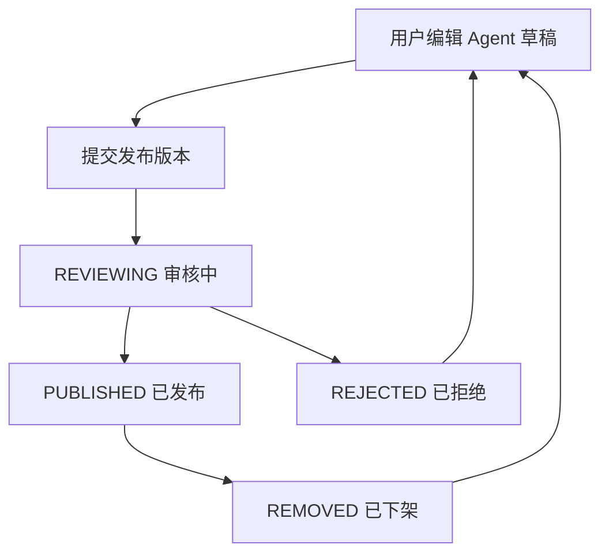
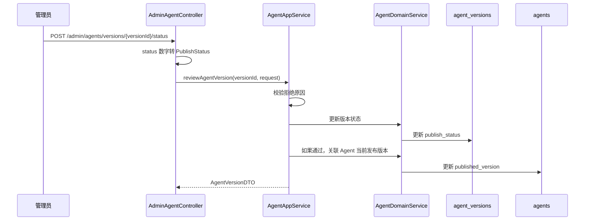

# 第 14 课：Agent 市场与状态流转（小白版）

## 这节课要解决什么问题

上一课我们讲了 Agent 版本。

用户点击发布后，系统会生成一个版本快照。

但这个版本不会立刻展示给所有人。

它要先经过一个平台流程：

```text
提交审核 -> 管理员审核 -> 通过后上架 -> 用户在市场搜索和添加
```

这一课我们就来理解：

```text
Agent 是怎么从私人草稿变成市场里的公开商品的？
```

## 本课学习目标

学完本课后，你应该能回答：

1. Agent 市场是什么？
2. 为什么发布后要审核？
3. `REVIEWING`、`PUBLISHED`、`REJECTED`、`REMOVED` 分别是什么意思？
4. 用户侧和管理员侧分别有哪些接口？
5. 市场搜索为什么查的是版本，不是草稿？
6. 管理员审核时源码怎么走？
7. 状态流转里有哪些权限约束？

## 先用“应用商店”理解 Agent 市场

你可以把 Agent 市场理解成手机应用商店。

开发者做了一个 App，不能随便直接出现在应用商店里。

一般要经历：

1. 开发者提交 App。
2. 平台审核。
3. 审核通过后上架。
4. 用户搜索、安装。
5. 如果 App 有问题，平台可以下架。

Agent 市场也是类似：

| 应用商店 | AgentX |
| --- | --- |
| 开发者提交 App | 用户发布 Agent 版本 |
| 平台审核 | 管理员审核 Agent 版本 |
| App 上架 | Agent 版本变为已发布 |
| 用户安装 App | 用户把 Agent 添加到工作区 |
| 平台下架 App | Agent 版本变为已下架 |

## Agent 的四种发布状态

发布状态定义在：

```text
E:\agentx\AgentX\AgentX\src\main\java\org\xhy\domain\agent\constant\PublishStatus.java
```

四种状态：

| 状态 | 数字 | 中文 | 小白解释 |
| --- | --- | --- | --- |
| `REVIEWING` | 1 | 审核中 | 用户提交了，管理员还没决定 |
| `PUBLISHED` | 2 | 已发布 | 审核通过，能在市场展示 |
| `REJECTED` | 3 | 拒绝 | 审核不通过 |
| `REMOVED` | 4 | 已下架 | 曾经发布过，但现在不展示 |

这四种状态保存在 `agent_versions` 表的：

```text
publish_status
```

## 状态流转图

简化理解如下：



注意：

```text
草稿本身不在 PublishStatus 里。
PublishStatus 管的是 agent_versions 里的发布版本。
```

## 为什么市场展示版本，而不是草稿

市场不能直接展示用户正在编辑的草稿。

原因很简单：

1. 草稿可能还没写完。
2. 草稿可能包含测试提示词。
3. 草稿随时变化，用户体验不稳定。
4. 平台无法保证草稿已经审核过。

所以市场展示的是：

```text
已发布的 AgentVersion。
```

也就是：

```text
publishStatus = PUBLISHED 的版本快照。
```

## 用户侧：搜索已上架 Agent

用户侧搜索已发布 Agent 的接口在：

```text
E:\agentx\AgentX\AgentX\src\main\java\org\xhy\interfaces\api\portal\agent\PortalAgentController.java
```

方法是：

```java
@GetMapping("/published")
public Result<List<AgentVersionDTO>> getPublishedAgents(SearchAgentsRequest searchAgentsRequest) {
    String userId = UserContext.getCurrentUserId();
    return Result.success(agentAppService.getPublishedAgentsByName(searchAgentsRequest, userId));
}
```

这说明：

```text
普通用户看到的是已发布 Agent 版本列表。
```

返回的是：

```text
AgentVersionDTO
```

不是 `AgentDTO`。

这再次说明市场看的是版本快照。

## getPublishedAgentsByName 做什么

在：

```text
E:\agentx\AgentX\AgentX\src\main\java\org\xhy\application\agent\service\AgentAppService.java
```

有方法：

```java
public List<AgentVersionDTO> getPublishedAgentsByName(SearchAgentsRequest searchAgentsRequest, String userId)
```

它大概做几件事：

1. 根据搜索条件构造查询对象。
2. 查询已发布版本。
3. 判断当前用户是否已经把这些 Agent 加入工作区。
4. 返回版本 DTO 列表。

第 3 点很贴心。

因为市场页面通常需要显示：

```text
这个 Agent 你是否已经添加过。
```

## 管理员侧：查看版本列表

管理员入口在：

```text
E:\agentx\AgentX\AgentX\src\main\java\org\xhy\interfaces\api\admin\AdminAgentController.java
```

查询版本列表：

```java
@GetMapping("/versions")
public Result<List<AgentVersionDTO>> getVersions(
        @RequestParam(required = false) Integer status,
        @RequestParam(required = false) String agentId) {
}
```

管理员可以：

- 按状态查看版本
- 查看某个 Agent 的所有版本
- 找出待审核的版本

这就像后台管理系统里的“待审核列表”。

## 管理员侧：审核版本状态

管理员更新状态的接口：

```java
@PostMapping("/versions/{versionId}/status")
public Result<AgentVersionDTO> updateVersionStatus(
        @PathVariable String versionId,
        @RequestParam Integer status,
        @RequestParam(required = false) String reason) {
}
```

这个接口可以把某个版本改成：

- 已发布
- 已拒绝
- 已下架
- 审核中

如果是拒绝，必须提供原因：

```text
拒绝操作需要提供原因。
```

这很合理。

因为用户需要知道哪里不符合要求，才能修改后重新发布。

## ReviewAgentVersionRequest 是什么

文件位置：

```text
E:\agentx\AgentX\AgentX\src\main\java\org\xhy\interfaces\dto\agent\request\ReviewAgentVersionRequest.java
```

它有两个核心字段：

| 字段 | 小白解释 |
| --- | --- |
| `status` | 管理员决定改成什么状态 |
| `rejectReason` | 如果拒绝，说明拒绝原因 |

它的校验逻辑是：

```text
如果状态是 REJECTED，拒绝原因不能为空。
```

## 审核流程总览

管理员审核流程可以简化为：



你可以把它理解成：

```text
管理员在后台给这个版本盖章。
```

盖章通过后，这个版本才真正能在市场里出现。

## 状态更新的领域服务

状态更新在：

```text
E:\agentx\AgentX\AgentX\src\main\java\org\xhy\domain\agent\service\AgentDomainService.java
```

相关方法：

```java
public AgentVersionEntity updateVersionPublishStatus(String versionId, PublishStatus status)
```

它会：

1. 找到版本。
2. 调用 `version.updatePublishStatus(status)`。
3. 保存更新。

如果状态是拒绝，`AgentVersionEntity` 里还有：

```java
public void reject(String reason)
```

它会保存拒绝原因和审核时间。

## 已发布后 AgentEntity 会发生什么

上一课讲过，`AgentEntity` 有字段：

```text
publishedVersion
```

这个字段表示：

```text
当前 Agent 对外发布的是哪个版本。
```

当管理员审核通过后，系统需要让 Agent 指向这个正式版本。

否则市场虽然有版本，但 Agent 自己不知道哪个版本是当前发布版。

你可以理解成：

```text
AgentEntity 是书，AgentVersionEntity 是印刷批次，publishedVersion 指向当前公开销售的那一批。
```

## 私有、待审核、已上架、被拒绝、已下架

课程大纲里提到这些词。

可以这样理解：

| 词 | 对应含义 |
| --- | --- |
| 私有 | 只在自己的 Agent 列表和工作区使用，还没公开发布 |
| 待审核 | 已提交版本，状态是 `REVIEWING` |
| 已上架 | 审核通过，状态是 `PUBLISHED` |
| 被拒绝 | 审核失败，状态是 `REJECTED` |
| 已下架 | 不再市场展示，状态是 `REMOVED` |

其中“私有”更像业务概念，不是 `PublishStatus` 里的一个状态。

如果一个 Agent 没有已发布版本，你可以先把它理解成私有。

## 权限约束有哪些

Agent 市场里至少有两类角色：

| 角色 | 能做什么 |
| --- | --- |
| 普通用户 | 创建 Agent、编辑 Agent、提交发布、搜索已发布 Agent、添加到工作区 |
| 管理员 | 查看全部 Agent 和版本、审核版本、拒绝、下架 |

普通用户不能自己把版本改成已发布。

否则审核系统就没有意义了。

管理员接口放在：

```text
/admin/agents
```

普通用户接口放在：

```text
/agents
```

路径上已经能看出权限边界。

## 市场搜索和工作区的关系

市场搜索只是“看到别人发布的 Agent”。

真正使用前，用户通常要把它加入自己的工作区。

也就是第 15 课要讲的：

```text
Agent 市场负责发现，工作区负责使用。
```

## 本课小结

这一课你要记住：

```text
Agent 市场展示的是审核通过的版本快照，不是正在编辑的草稿。
```

核心点：

- 发布状态保存在 `agent_versions.publish_status`
- `REVIEWING` 是审核中
- `PUBLISHED` 是已发布
- `REJECTED` 是被拒绝
- `REMOVED` 是已下架
- 用户通过 `/agents/published` 搜索市场
- 管理员通过 `/admin/agents/versions` 管理版本
- 拒绝版本时需要填写原因
- 审核通过后，Agent 的 `publishedVersion` 会指向正式版本

## 本课源码阅读路线

建议按这个顺序看：

1. `E:\agentx\AgentX\AgentX\src\main\java\org\xhy\domain\agent\constant\PublishStatus.java`
2. `E:\agentx\AgentX\AgentX\src\main\java\org\xhy\interfaces\api\portal\agent\PortalAgentController.java`
3. `E:\agentx\AgentX\AgentX\src\main\java\org\xhy\interfaces\api\admin\AdminAgentController.java`
4. `E:\agentx\AgentX\AgentX\src\main\java\org\xhy\interfaces\dto\agent\request\ReviewAgentVersionRequest.java`
5. `E:\agentx\AgentX\AgentX\src\main\java\org\xhy\application\agent\service\AgentAppService.java`
6. `E:\agentx\AgentX\AgentX\src\main\java\org\xhy\domain\agent\service\AgentDomainService.java`

## 课后练习

### 练习 1：解释四种状态

请写出这四个状态的中文含义：

```text
REVIEWING
PUBLISHED
REJECTED
REMOVED
```

参考答案：

```text
审核中、已发布、拒绝、已下架。
```

### 练习 2：判断市场展示什么

请回答：

```text
Agent 市场展示的是 agents 表里的草稿，还是 agent_versions 表里的已发布版本？
```

参考答案：

```text
展示 agent_versions 表里状态为 PUBLISHED 的版本。
```

### 练习 3：为什么拒绝要有原因

请用一句话解释：

```text
为什么管理员拒绝版本时要填写 rejectReason？
```

参考答案：

```text
因为用户需要知道版本为什么没通过，才能修改后重新提交。
```

## 下一课预告

下一课我们会讲：

```text
工作区与 Widget。
```

你会理解：

- 用户为什么要把 Agent 加入工作区
- 工作区里的模型配置在哪里
- Widget 是什么
- publicId 为什么重要
- Agent 如何嵌入到外部网页
