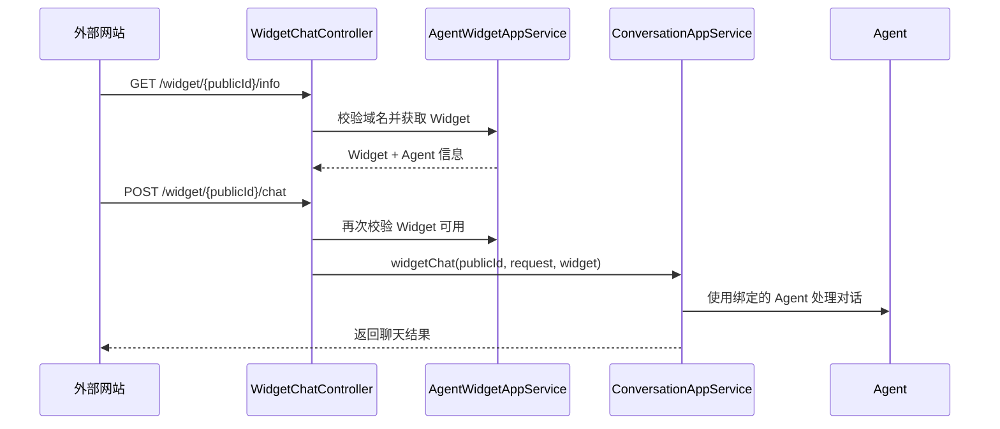

# 第 15 课：工作区与 Widget（小白版）

## 这节课要解决什么问题

前面我们讲了：

- Agent 是一份助手档案
- Agent 可以发布版本
- 发布版本审核通过后可以进入市场

这一课继续讲两个非常实用的功能：

```text
工作区和 Widget。
```

简单说：

```text
工作区解决“我怎么使用这个 Agent”。
Widget 解决“我怎么把这个 Agent 放到外部网页上”。
```

## 本课学习目标

学完本课后，你应该能回答：

1. 工作区是什么？
2. `agent_workspace` 表保存什么？
3. 为什么不能重复添加同一个 Agent？
4. 为什么不能把自己的 Agent 当作市场 Agent 添加？
5. 工作区里的模型配置是什么？
6. Widget 是什么？
7. `publicId` 是什么？
8. Widget 如何限制访问域名？
9. Widget 的公开聊天入口在哪里？

## 先用“我的常用应用”理解工作区

手机里有应用商店，也有你的手机桌面。

应用商店里有很多 App。

但你真正常用的是你安装到手机里的 App。

AgentX 也类似：

| 手机场景 | AgentX |
| --- | --- |
| 应用商店 | Agent 市场 |
| 安装 App | 添加 Agent 到工作区 |
| 手机桌面 | 我的工作区 |
| App 设置 | 工作区模型配置 |

所以：

```text
市场是用来发现 Agent 的。
工作区是用来使用 Agent 的。
```

## 工作区保存在哪里

工作区表是：

```text
agent_workspace
```

SQL 位置：

```text
E:\agentx\AgentX\docs\sql\01_init.sql
```

核心字段：

| 字段 | 小白解释 |
| --- | --- |
| `id` | 工作区记录编号 |
| `agent_id` | 哪个 Agent |
| `user_id` | 哪个用户 |
| `llm_model_config` | 这个用户使用该 Agent 时的模型配置 |
| `created_at` | 创建时间 |
| `updated_at` | 更新时间 |
| `deleted_at` | 删除时间 |

Java 类：

```text
E:\agentx\AgentX\AgentX\src\main\java\org\xhy\domain\agent\model\AgentWorkspaceEntity.java
```

## 为什么工作区要单独一张表

因为 Agent 和用户之间不是简单的一对一。

一个 Agent 可以被很多用户添加。

一个用户也可以添加很多 Agent。

所以需要一张中间表记录：

```text
哪个用户添加了哪个 Agent。
```

这就像：

```text
应用商店里一个 App 可以被很多人安装。
每个人手机里也可以安装很多 App。
```

## 工作区里的模型配置

`agent_workspace` 表里有一个字段：

```text
llm_model_config
```

对应 Java 字段：

```java
private LLMModelConfig llmModelConfig;
```

它保存：

- 使用哪个模型
- 温度参数
- topP
- topK
- token 策略

为什么模型配置放在工作区？

因为同一个 Agent 被不同用户使用时，用户可能想用不同模型。

例如：

| 用户 | 同一个 Agent | 模型偏好 |
| --- | --- | --- |
| 用户 A | 英语陪练 Agent | 稳定、少发散 |
| 用户 B | 英语陪练 Agent | 活泼、有创造力 |

所以：

```text
Agent 档案保存“它是谁”，工作区保存“我怎么用它”。
```

## 工作区接口在哪里

工作区入口在：

```text
E:\agentx\AgentX\AgentX\src\main\java\org\xhy\interfaces\api\portal\agent\PortalWorkspaceController.java
```

主要接口：

| 接口 | 小白解释 |
| --- | --- |
| `GET /agents/workspaces/agents` | 获取我的工作区 Agent |
| `POST /agents/workspaces/{agentId}` | 添加 Agent 到工作区 |
| `DELETE /agents/workspaces/agents/{id}` | 从工作区删除 Agent |
| `PUT /agents/workspaces/{agentId}/model/config` | 保存模型配置 |
| `GET /agents/workspaces/{agentId}/model-config` | 获取模型配置 |

## 添加 Agent 到工作区的规则

核心代码在：

```text
E:\agentx\AgentX\AgentX\src\main\java\org\xhy\application\agent\service\AgentWorkspaceAppService.java
```

方法：

```java
public void addAgent(String agentId, String userId)
```

它会检查几件事：

1. Agent 是否存在。
2. 不能添加自己的 Agent。
3. 不能重复添加同一个 Agent。
4. Agent 必须启用。
5. Agent 必须有已发布版本。
6. 已发布版本状态必须是 `PUBLISHED`。
7. 通过后创建工作区记录。

## 为什么不能添加自己的 Agent

代码里有：

```text
不可添加自己的助理
```

这不是说你不能使用自己创建的 Agent。

而是因为：

```text
自己创建 Agent 时，系统已经自动给你创建了工作区记录。
```

第 12 课讲过，创建 Agent 时会创建：

```text
AgentWorkspaceEntity(agentId, userId, new LLMModelConfig())
```

所以自己的 Agent 不需要再通过市场添加一遍。

## 为什么不能重复添加

如果重复添加，同一个用户的工作区里会出现两个一模一样的 Agent。

这会带来很多麻烦：

- 页面显示重复
- 模型配置不知道用哪份
- 删除时不知道删哪条
- 对话记录容易混乱

所以系统会检查：

```text
这个 agentId + userId 是否已经存在。
```

存在就提示：

```text
不可重复添加助理。
```

## 删除工作区 Agent 会发生什么

删除工作区 Agent 时，不只是删工作区记录。

代码里还会：

1. 删除工作区记录。
2. 找到该 Agent 相关会话。
3. 删除会话。
4. 删除对话消息。

你可以理解成：

```text
从桌面卸载 App 时，也顺便清理这个 App 在你手机里的使用记录。
```

注意：

```text
删除工作区记录，不等于删除原始 Agent。
```

如果这个 Agent 是别人发布的，你只是从自己的工作区移除它。

## 什么是 Widget

Widget 可以翻译成“小组件”。

在 AgentX 里，它主要用于：

```text
把某个 Agent 嵌入到外部网站，让网站访客也能聊天。
```

比如你有一个公司官网，希望右下角出现一个客服聊天窗口。

这个聊天窗口背后可以接 AgentX 的 Agent。

这就是 Widget。

## Widget 保存在哪里

Widget 表是：

```text
agent_widgets
```

核心字段：

| 字段 | 小白解释 |
| --- | --- |
| `id` | Widget 配置编号 |
| `agent_id` | 绑定哪个 Agent |
| `user_id` | 谁创建的 Widget |
| `public_id` | 对外访问用的公开编号 |
| `name` | Widget 名称 |
| `description` | 描述 |
| `model_id` | 使用哪个模型 |
| `provider_id` | 模型服务商 |
| `allowed_domains` | 允许访问的域名 |
| `daily_limit` | 每日调用限制 |
| `enabled` | 是否启用 |
| `widget_type` | Agent 类型还是 RAG 类型 |
| `knowledge_base_ids` | RAG 类型使用的知识库 |

Java 类：

```text
E:\agentx\AgentX\AgentX\src\main\java\org\xhy\domain\agent\model\AgentWidgetEntity.java
```

## publicId 是什么

`publicId` 是 Widget 的公开访问编号。

代码里会生成类似这样的值：

```text
widget_abcd1234efgh5678
```

它的作用是：

```text
让外部网页可以通过这个编号访问对应 Widget。
```

如果没有 `publicId`，外部网页就不知道要打开哪个聊天组件。

## Widget 管理接口在哪里

用户管理 Widget 的接口在：

```text
E:\agentx\AgentX\AgentX\src\main\java\org\xhy\interfaces\api\portal\agent\AgentWidgetController.java
```

主要接口：

| 接口 | 小白解释 |
| --- | --- |
| `POST /agents/{agentId}/widgets` | 创建 Widget |
| `GET /agents/{agentId}/widgets` | 获取某个 Agent 的 Widget |
| `GET /agents/{agentId}/widgets/{widgetId}` | 获取 Widget 详情 |
| `PUT /agents/{agentId}/widgets/{widgetId}` | 更新 Widget |
| `POST /agents/{agentId}/widgets/{widgetId}/status` | 启用或禁用 |
| `DELETE /agents/{agentId}/widgets/{widgetId}` | 删除 Widget |
| `GET /user/widgets` | 获取当前用户所有 Widget |

## 创建 Widget 的流程

核心方法在：

```text
E:\agentx\AgentX\AgentX\src\main\java\org\xhy\application\agent\service\AgentWidgetAppService.java
```

创建方法：

```java
public AgentWidgetDTO createWidget(String agentId, CreateWidgetRequest request, String userId)
```

它会：

1. 验证这个 Agent 是否属于当前用户。
2. 把请求转换成 `AgentWidgetEntity`。
3. 生成唯一 `publicId`。
4. 保存到 `agent_widgets` 表。
5. 查询模型和服务商信息。
6. 生成嵌入代码。
7. 返回 `AgentWidgetDTO`。

## 嵌入代码是什么

`AgentWidgetAssembler` 里会生成嵌入代码。

文件位置：

```text
E:\agentx\AgentX\AgentX\src\main\java\org\xhy\application\agent\assembler\AgentWidgetAssembler.java
```

里面会生成类似：

```html
<iframe
  src="http://localhost:3000/widget/widget_xxxxx"
  width="400"
  height="600">
</iframe>
```

这就是把 Agent 聊天窗口放到其他网页上的方式。

小白理解：

```text
iframe 就像网页里开了一个小窗户，小窗户里显示 AgentX 的聊天页面。
```

## 域名白名单是什么

Widget 有一个字段：

```text
allowedDomains
```

它表示：

```text
允许哪些网站使用这个 Widget。
```

例如你只想让公司官网能用：

```text
www.example.com
```

那其他网站就不能随便拿你的 Widget 去用。

在 `AgentWidgetEntity` 里有方法：

```java
public boolean isDomainAllowed(String domain)
```

如果 `allowedDomains` 为空，表示允许所有域名。

如果配置了域名，就要匹配成功才能访问。

## Widget 的公开访问入口

Widget 面向外部访问，所以有一个公开 API：

```text
E:\agentx\AgentX\AgentX\src\main\java\org\xhy\interfaces\api\public_api\WidgetChatController.java
```

请求路径：

```text
/widget
```

主要接口：

| 接口 | 小白解释 |
| --- | --- |
| `GET /widget/{publicId}/info` | 获取 Widget 信息 |
| `POST /widget/{publicId}/chat` | 流式聊天 |
| `POST /widget/{publicId}/chat/sync` | 同步聊天 |

注意：

```text
这里用 publicId，不用 agentId。
```

因为外部网页只应该拿到公开访问编号，不应该直接操作你的 Agent 管理数据。

## Widget 公开聊天流程

简化流程：



你可以把 `publicId` 理解成：

```text
外部网站进入这间客服聊天室的门牌号。
```

## WidgetType：Agent 和 RAG

Widget 类型定义在：

```text
E:\agentx\AgentX\AgentX\src\main\java\org\xhy\domain\agent\constant\WidgetType.java
```

有两种：

| 类型 | 小白解释 |
| --- | --- |
| `AGENT` | 使用 Agent 的完整能力，包括工具流程 |
| `RAG` | 偏向直接使用知识库问答 |

你现在先记住：

```text
Widget 不一定只能绑定普通 Agent，也可以面向知识库问答场景。
```

后面讲 RAG 时会更清楚。

## 工作区和 Widget 的区别

| 对比项 | 工作区 | Widget |
| --- | --- | --- |
| 给谁用 | 登录用户自己用 | 外部网站访客用 |
| 主要表 | `agent_workspace` | `agent_widgets` |
| 关键字段 | `agentId + userId` | `publicId` |
| 是否需要登录 | 通常需要 | 公开访问通常不需要 |
| 主要用途 | 收藏和配置 Agent | 嵌入网页聊天 |
| 模型配置 | `llm_model_config` | `model_id`、`provider_id` |

一句话记忆：

```text
工作区是我自己的 Agent 桌面，Widget 是放到别人网页上的聊天窗口。
```

## 本课小结

这一课你要记住：

- 工作区表示用户添加和使用哪些 Agent
- 工作区数据保存在 `agent_workspace`
- 工作区里可以保存每个用户自己的模型配置
- 添加市场 Agent 前要检查是否已发布、是否启用、是否重复添加
- Widget 用于把 Agent 嵌入外部网页
- Widget 数据保存在 `agent_widgets`
- `publicId` 是外部访问 Widget 的公开编号
- `allowedDomains` 用于限制哪些网站可以使用
- 公开聊天入口在 `WidgetChatController`
- Widget 可以是 `AGENT` 类型，也可以是 `RAG` 类型

## 本课源码阅读路线

建议按这个顺序看：

1. `E:\agentx\AgentX\AgentX\src\main\java\org\xhy\interfaces\api\portal\agent\PortalWorkspaceController.java`
2. `E:\agentx\AgentX\AgentX\src\main\java\org\xhy\application\agent\service\AgentWorkspaceAppService.java`
3. `E:\agentx\AgentX\AgentX\src\main\java\org\xhy\domain\agent\model\AgentWorkspaceEntity.java`
4. `E:\agentx\AgentX\AgentX\src\main\java\org\xhy\interfaces\api\portal\agent\AgentWidgetController.java`
5. `E:\agentx\AgentX\AgentX\src\main\java\org\xhy\application\agent\service\AgentWidgetAppService.java`
6. `E:\agentx\AgentX\AgentX\src\main\java\org\xhy\domain\agent\model\AgentWidgetEntity.java`
7. `E:\agentx\AgentX\AgentX\src\main\java\org\xhy\application\agent\assembler\AgentWidgetAssembler.java`
8. `E:\agentx\AgentX\AgentX\src\main\java\org\xhy\interfaces\api\public_api\WidgetChatController.java`

## 课后练习

### 练习 1：解释工作区

请用一句话解释：

```text
工作区是什么？
```

参考答案：

```text
工作区是当前用户添加和使用 Agent 的地方，并保存用户自己的模型配置。
```

### 练习 2：解释 Widget

请用一句话解释：

```text
Widget 是什么？
```

参考答案：

```text
Widget 是把 Agent 以聊天小组件形式嵌入外部网页的一套配置和公开访问入口。
```

### 练习 3：区分 agentId 和 publicId

请回答：

```text
外部网页访问 Widget 时，主要用 agentId 还是 publicId？
```

参考答案：

```text
主要用 publicId，因为它是给外部访问准备的公开编号。
```

## 下一阶段预告

从第 16 课开始，我们进入：

```text
一次对话主链路。
```

也就是用户发一句话后，系统如何：

- 创建会话
- 保存消息
- 读取历史上下文
- 调用模型
- 使用工具
- 返回回答

这会是理解 Agent 真正运行机制的关键阶段。
