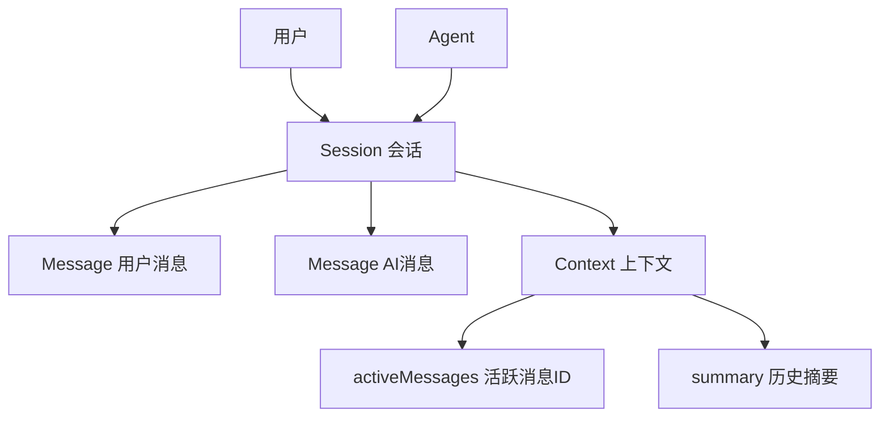

# 第 16 课：会话与消息模型（小白版）

## 这节课要解决什么问题

从这一课开始，我们进入“真正聊天”的主链路。

用户在页面里输入一句话，比如：

```text
帮我写一封请假邮件。
```

系统不是只把这句话直接丢给大模型。

它还要知道：

- 这是哪个用户发的？
- 属于哪个聊天窗口？
- 之前聊过什么？
- 这次消息要不要保存？
- 大模型回复后要保存在哪里？
- 下次聊天时要带哪些历史消息？

这些问题对应三个核心概念：

```text
Session、Message、Context。
```

## 本课学习目标

学完本课后，你应该能回答：

1. Session 是什么？
2. Message 是什么？
3. Context 是什么？
4. 用户消息和 AI 消息有什么区别？
5. `Role.USER`、`Role.ASSISTANT`、`Role.SYSTEM` 是什么？
6. 历史消息为什么不能无限塞给模型？
7. 消息什么时候入库？
8. 第 17 课的聊天主流程为什么要先准备上下文？

## 先用“微信聊天窗口”理解

你可以把一次 Agent 对话理解成微信聊天。

| 微信里 | AgentX 里 |
| --- | --- |
| 一个聊天窗口 | Session |
| 聊天窗口里的一句话 | Message |
| 最近需要记住的聊天记录 | Context |
| 你发的话 | 用户消息 |
| 对方回的话 | AI 消息 |

所以：

```text
Session 是一场对话的容器。
Message 是对话里的一条消息。
Context 是下次问模型时要带上的历史上下文。
```

## Session：一场对话

Session 对应源码：

```text
E:\agentx\AgentX\AgentX\src\main\java\org\xhy\domain\conversation\model\SessionEntity.java
```

它对应数据库表：

```text
sessions
```

核心字段：

| 字段 | 小白解释 |
| --- | --- |
| `id` | 会话 ID |
| `title` | 会话标题 |
| `userId` | 属于哪个用户 |
| `agentId` | 这个会话使用哪个 Agent |
| `description` | 会话描述 |
| `isArchived` | 是否归档 |
| `metadata` | 额外信息 |

你可以理解成：

```text
Session 是一个聊天房间。
```

每个聊天房间都有自己的 ID，也知道它属于哪个用户、使用哪个 Agent。

## 创建会话的入口

会话接口在：

```text
E:\agentx\AgentX\AgentX\src\main\java\org\xhy\interfaces\api\portal\agent\PortalAgentSessionController.java
```

创建会话的接口：

```java
@PostMapping("/{agentId}")
public Result<SessionDTO> createSession(@PathVariable String agentId) {
    String userId = UserContext.getCurrentUserId();
    return Result.success(agentSessionAppService.createSession(userId, agentId));
}
```

这说明创建会话需要：

- 当前用户 `userId`
- 要聊天的 Agent：`agentId`

创建后，前端就会拿到一个 `sessionId`。

后续发消息时必须带上这个 `sessionId`。

## Message：一条消息

Message 对应源码：

```text
E:\agentx\AgentX\AgentX\src\main\java\org\xhy\domain\conversation\model\MessageEntity.java
```

它对应数据库表：

```text
messages
```

核心字段：

| 字段 | 小白解释 |
| --- | --- |
| `id` | 消息 ID |
| `sessionId` | 属于哪个会话 |
| `role` | 谁说的 |
| `content` | 消息内容 |
| `messageType` | 消息类型 |
| `tokenCount` | Token 数 |
| `bodyTokenCount` | 本条消息主体 Token 数 |
| `provider` | 用的模型服务商 |
| `model` | 用的模型 |
| `metadata` | 额外信息 |
| `fileUrls` | 附带文件 |

一句话：

```text
Message 是聊天房间里的一句话。
```

## Role：谁说的话

消息角色定义在：

```text
E:\agentx\AgentX\AgentX\src\main\java\org\xhy\domain\conversation\constant\Role.java
```

主要有：

| Role | 小白解释 |
| --- | --- |
| `USER` | 用户说的话 |
| `ASSISTANT` | AI 回复的话 |
| `SYSTEM` | 系统提示词 |
| `SUMMARY` | 历史摘要 |

例如：

| 内容 | Role |
| --- | --- |
| 帮我写请假邮件 | `USER` |
| 当然，下面是一封请假邮件 | `ASSISTANT` |
| 你是一个专业办公助手 | `SYSTEM` |
| 用户之前在讨论请假邮件 | `SUMMARY` |

## MessageType：消息的类型

消息类型定义在：

```text
E:\agentx\AgentX\AgentX\src\main\java\org\xhy\domain\conversation\constant\MessageType.java
```

常见类型：

| 类型 | 小白解释 |
| --- | --- |
| `TEXT` | 普通文本 |
| `TOOL_CALL` | 工具调用消息 |
| `TASK_EXEC` | 任务执行消息 |
| `RAG_RETRIEVAL_START` | RAG 检索开始 |
| `RAG_RETRIEVAL_PROGRESS` | RAG 检索中 |
| `RAG_RETRIEVAL_END` | RAG 检索结束 |
| `RAG_ANSWER_PROGRESS` | RAG 回答片段 |
| `RAG_ANSWER_END` | RAG 回答结束 |

为什么需要 `MessageType`？

因为前端不能只看到一堆文本。

它还要知道：

- 这是普通回答
- 这是工具调用提示
- 这是检索进度
- 这是任务执行状态
- 这是结束信号

## Context：上下文

Context 对应源码：

```text
E:\agentx\AgentX\AgentX\src\main\java\org\xhy\domain\conversation\model\ContextEntity.java
```

它对应数据库表：

```text
context
```

核心字段：

| 字段 | 小白解释 |
| --- | --- |
| `id` | 上下文 ID |
| `sessionId` | 属于哪个会话 |
| `activeMessages` | 当前需要带给模型的消息 ID 列表 |
| `summary` | 历史消息摘要 |

你可以这样理解：

```text
Context 不是保存全部聊天记录，而是保存“下次问模型时应该带哪些历史信息”。
```

## 为什么不能把全部历史都给模型

大模型不是无限记忆的。

每次请求模型时，都有上下文长度限制。

如果一个会话聊了几百轮，全部塞给模型会有问题：

1. 请求太大。
2. 费用更高。
3. 响应更慢。
4. 超过模型上下文限制。

所以系统要管理：

```text
哪些历史消息继续活跃，哪些历史消息变成摘要。
```

这就是 `ContextEntity.activeMessages` 和 `summary` 的意义。

## 历史消息读取

在聊天前，`ConversationAppService` 会准备环境。

其中有一步：

```text
setupContextAndHistory
```

它大概做这些事：

1. 根据 `sessionId` 查询 `ContextEntity`。
2. 如果有上下文，就读取 `activeMessages` 对应的消息。
3. 根据 Token 策略处理历史消息。
4. 把最终历史消息放入 `ChatContext`。

也就是说：

```text
ChatContext 里会带着这次聊天所需的历史消息。
```

第 17 课会详细讲 `ChatContext`。

## 消息什么时候入库

在 `AbstractMessageHandler` 里，聊天时会创建两条消息：

```text
用户消息
AI 消息
```

普通流式对话的大致入库顺序是：

1. 创建用户消息对象。
2. 创建 AI 消息对象。
3. 保存用户消息，并更新上下文。
4. 模型持续返回片段。
5. 模型完整回答后，把完整 AI 内容保存。
6. 更新上下文里的活跃消息。

也就是说：

```text
用户消息通常先保存，AI 消息等完整生成后保存。
```

工具调用消息也可能单独保存成 `TOOL_CALL` 类型。

## 一次对话的数据关系



这张图可以这样读：

- 一个用户可以有多个会话。
- 一个会话绑定一个 Agent。
- 一个会话里有多条消息。
- 一个会话有上下文记录。
- 上下文决定下次对话带哪些历史消息。

## 本课小结

这一课你要记住：

```text
Session 是聊天房间，Message 是聊天记录，Context 是给模型看的历史上下文清单。
```

核心点：

- `SessionEntity` 对应 `sessions`
- `MessageEntity` 对应 `messages`
- `ContextEntity` 对应 `context`
- `Role` 表示谁说的话
- `MessageType` 表示消息是什么类型
- 历史消息不能无限给模型
- 用户消息通常先保存
- AI 消息通常完整生成后保存

## 本课源码阅读路线

建议按这个顺序看：

1. `E:\agentx\AgentX\AgentX\src\main\java\org\xhy\interfaces\api\portal\agent\PortalAgentSessionController.java`
2. `E:\agentx\AgentX\AgentX\src\main\java\org\xhy\domain\conversation\model\SessionEntity.java`
3. `E:\agentx\AgentX\AgentX\src\main\java\org\xhy\domain\conversation\model\MessageEntity.java`
4. `E:\agentx\AgentX\AgentX\src\main\java\org\xhy\domain\conversation\model\ContextEntity.java`
5. `E:\agentx\AgentX\AgentX\src\main\java\org\xhy\domain\conversation\constant\Role.java`
6. `E:\agentx\AgentX\AgentX\src\main\java\org\xhy\domain\conversation\constant\MessageType.java`

## 课后练习

### 练习 1：三个概念

请用自己的话解释：

```text
Session、Message、Context 分别是什么？
```

参考答案：

```text
Session 是一场对话，Message 是对话中的一条消息，Context 是下次请求模型时要带上的历史上下文。
```

### 练习 2：判断角色

用户说“帮我写日报”，AI 回复“好的”，它们分别是什么 Role？

参考答案：

```text
用户消息是 USER，AI 回复是 ASSISTANT。
```

## 下一课预告

下一课我们会看：

```text
ConversationAppService 如何编排一次聊天请求。
```

也就是从 `ChatRequest` 开始，到 `ChatContext` 准备完成，再交给消息处理器。
