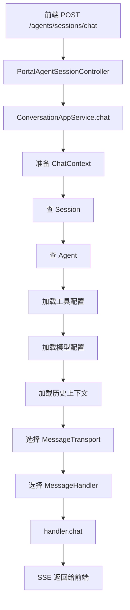

# 第 17 课：ConversationAppService 主流程（小白版）

## 这节课要解决什么问题

上一课我们认识了：

```text
Session、Message、Context。
```

这一课看一次聊天请求真正进入后端后，应用层怎么编排。

核心类是：

```text
E:\agentx\AgentX\AgentX\src\main\java\org\xhy\application\conversation\service\ConversationAppService.java
```

你可以把它理解成：

```text
一次聊天请求的总调度员。
```

## 本课学习目标

学完本课后，你应该能回答：

1. `ChatRequest` 里有什么？
2. `ConversationAppService.chat` 做了哪几步？
3. `ChatContext` 是什么？
4. 为什么聊天前要查 Session？
5. 为什么要加载 Agent？
6. 为什么要加载模型配置？
7. 为什么要加载工具和知识库配置？
8. 流式响应和同步响应有什么区别？

## 先用“餐厅点餐”理解主流程

用户发消息就像客人点餐：

1. 客人说想吃什么。
2. 服务员确认桌号。
3. 后厨确认菜单、厨师、食材。
4. 厨房开始做菜。
5. 菜一点点端上桌，或者一次性端上桌。

聊天主流程也类似：

| 餐厅 | AgentX |
| --- | --- |
| 客人说想吃什么 | 用户消息 |
| 桌号 | `sessionId` |
| 菜单 | Agent 配置 |
| 厨师 | 模型 |
| 食材 | 历史消息、工具、知识库 |
| 一点点端菜 | SSE 流式响应 |
| 一次性端菜 | 同步响应 |

## ChatRequest：前端提交的聊天表单

文件位置：

```text
E:\agentx\AgentX\AgentX\src\main\java\org\xhy\application\conversation\dto\ChatRequest.java
```

核心字段：

```java
private String message;
private String sessionId;
private List<String> fileUrls = new ArrayList<>();
```

小白解释：

| 字段 | 含义 |
| --- | --- |
| `message` | 用户这次发的文字 |
| `sessionId` | 属于哪个聊天会话 |
| `fileUrls` | 这次随消息带的文件 |

这里有两个必填校验：

```text
消息内容不可为空
会话 id 不可为空
```

## 聊天入口在哪里

接口入口在：

```text
E:\agentx\AgentX\AgentX\src\main\java\org\xhy\interfaces\api\portal\agent\PortalAgentSessionController.java
```

方法：

```java
@PostMapping("/chat")
public SseEmitter chat(@RequestBody @Validated ChatRequest chatRequest) {
    return conversationAppService.chat(chatRequest, UserContext.getCurrentUserId());
}
```

它做两件事：

1. 接收 `ChatRequest`。
2. 把请求交给 `ConversationAppService.chat`。

注意返回值是：

```text
SseEmitter
```

说明普通聊天默认是流式返回。

## ConversationAppService.chat 的四大步骤

核心方法：

```java
public SseEmitter chat(ChatRequest chatRequest, String userId)
```

它的大致流程：

```text
1. 准备对话环境 ChatContext
2. 获取传输方式 SSE
3. 选择消息处理器
4. 执行聊天，并注册会话用于中断
```

源码里的关键步骤：

```java
ChatContext environment = prepareEnvironmentByRequestType(chatRequest, userId);

MessageTransport<SseEmitter> transport =
    transportFactory.getTransport(MessageTransportFactory.TRANSPORT_TYPE_SSE);

AbstractMessageHandler handler = messageHandlerFactory.getHandler(chatRequest);

SseEmitter emitter = handler.chat(environment, transport);

chatSessionManager.registerSession(chatRequest.getSessionId(), emitter);
```

一句话记忆：

```text
ConversationAppService 不亲自生成回答，它负责把所有材料准备好，再交给处理器。
```

## ChatContext：聊天环境包

`ChatContext` 文件：

```text
E:\agentx\AgentX\AgentX\src\main\java\org\xhy\application\conversation\service\handler\context\ChatContext.java
```

它像一个大包，把聊天所需材料装进去：

| 字段 | 小白解释 |
| --- | --- |
| `sessionId` | 当前会话 |
| `userId` | 当前用户 |
| `userMessage` | 用户这次说的话 |
| `agent` | 使用哪个 Agent |
| `model` | 最终使用哪个模型 |
| `provider` | 最终使用哪个服务商 |
| `llmModelConfig` | 模型参数 |
| `contextEntity` | 上下文记录 |
| `messageHistory` | 历史消息 |
| `mcpServerNames` | 可用工具服务 |
| `fileUrls` | 附带文件 |
| `streaming` | 是否流式返回 |
| `publicAccess` | 是否公开访问 |

你可以把它理解成：

```text
给后厨的一张完整备菜清单。
```

## 准备环境：查会话和 Agent

`prepareEnvironmentWithModel` 里第一步：

```text
获取会话和 Agent 信息。
```

它会：

1. 从 `ChatRequest` 里取 `sessionId`。
2. 根据 `sessionId + userId` 查会话。
3. 从会话里拿到 `agentId`。
4. 查询 Agent。
5. 检查 Agent 是否可用。

为什么要查 Session？

因为请求只带了 `sessionId`，系统要知道：

```text
这个会话属于哪个 Agent。
```

为什么还要带 `userId`？

为了防止用户访问别人的会话。

## 加载工具配置

Agent 可能绑定工具。

`ConversationAppService` 会调用：

```text
getMcpServerNames(agent.getToolIds(), userId)
```

它把 Agent 的工具 ID 转成当前用户已安装工具的 MCP Server 名称。

小白理解：

```text
Agent 档案里写着能用哪些工具，聊天前要把这些工具准备好。
```

第 21、22 课会详细讲工具和 MCP。

## 加载模型配置

聊天一定要用模型。

模型配置来自工作区：

```java
AgentWorkspaceEntity workspace = agentWorkspaceDomainService.getWorkspace(agentId, userId);
LLMModelConfig llmModelConfig = workspace.getLlmModelConfig();
```

也就是说：

```text
这个用户使用这个 Agent 时的模型配置，保存在工作区。
```

之后系统会找最终模型：

```text
getModelForChat(llmModelConfig, modelId, userId)
```

如果没有指定模型，就使用工作区配置或用户默认模型。

## 高可用选择 Provider

模型找到后，还要找服务商。

代码里会调用：

```text
highAvailabilityDomainService.selectBestProvider(...)
```

它的作用可以先理解为：

```text
从可用服务里挑一个更合适的模型服务实例。
```

如果某个服务不稳定，系统可以尝试选择其他可用服务。

第 19 课会专门讲模型服务商和高可用。

## 加载历史上下文

接下来会执行：

```text
setupContextAndHistory(chatContext, chatRequest)
```

它会：

1. 根据 `sessionId` 找 `ContextEntity`。
2. 读取 `activeMessages` 对应的历史消息。
3. 应用 Token 溢出策略。
4. 把最终历史消息放入 `chatContext.messageHistory`。
5. 如果本次有文件，也放进历史消息里供模型使用。

这一步很重要。

因为模型回答时不只看用户当前一句话，还要看必要历史。

## 选择传输方式

聊天返回方式由：

```text
MessageTransportFactory
```

决定。

普通页面聊天使用：

```text
TRANSPORT_TYPE_SSE
```

也就是流式响应。

外部 API 同步聊天可能使用：

```text
TRANSPORT_TYPE_SYNC
```

区别：

| 模式 | 小白解释 |
| --- | --- |
| SSE 流式 | AI 边生成边返回，用户能看到字一点点出现 |
| 同步 | 后端等完整答案生成后一次性返回 |

## 选择消息处理器

处理器由：

```text
MessageHandlerFactory
```

选择。

普通 `ChatRequest` 默认使用：

```text
agentMessageHandler
```

如果是 `RagChatRequest`，使用：

```text
ragMessageHandler
```

也就是说：

```text
ConversationAppService 只负责分派，不负责每种对话的细节。
```

第 18 课会专门讲处理器机制。

## 注册会话用于中断

流式聊天开始后，会注册到：

```text
ChatSessionManager
```

代码：

```java
chatSessionManager.registerSession(chatRequest.getSessionId(), emitter);
```

这样用户点击“停止生成”时，系统可以根据 `sessionId` 找到正在进行的 SSE 连接，并中断。

第 20 课会详细讲中断机制。

## 主流程图



## 本课小结

这一课你要记住：

```text
ConversationAppService 是一次聊天请求的应用层总调度。
```

它负责：

- 接收 `ChatRequest`
- 查询会话
- 查询 Agent
- 加载工具
- 加载模型配置
- 选择高可用 Provider
- 加载历史上下文
- 选择 SSE 或同步传输
- 选择消息处理器
- 注册会话用于中断

## 本课源码阅读路线

建议按这个顺序看：

1. `E:\agentx\AgentX\AgentX\src\main\java\org\xhy\application\conversation\dto\ChatRequest.java`
2. `E:\agentx\AgentX\AgentX\src\main\java\org\xhy\interfaces\api\portal\agent\PortalAgentSessionController.java`
3. `E:\agentx\AgentX\AgentX\src\main\java\org\xhy\application\conversation\service\ConversationAppService.java`
4. `E:\agentx\AgentX\AgentX\src\main\java\org\xhy\application\conversation\service\handler\context\ChatContext.java`
5. `E:\agentx\AgentX\AgentX\src\main\java\org\xhy\infrastructure\transport\MessageTransportFactory.java`
6. `E:\agentx\AgentX\AgentX\src\main\java\org\xhy\application\conversation\service\handler\MessageHandlerFactory.java`

## 课后练习

### 练习 1：解释 ChatContext

请用一句话解释：

```text
ChatContext 是什么？
```

参考答案：

```text
ChatContext 是一次聊天所需的完整环境包，里面包含用户、会话、Agent、模型、工具、历史消息等信息。
```

### 练习 2：补全流程

```text
ChatRequest -> ConversationAppService -> ________ -> MessageHandler -> SSE 返回
```

参考答案：

```text
ChatContext
```

## 下一课预告

下一课讲：

```text
MessageHandler 机制。
```

我们会看普通 Agent、RAG、预览对话为什么能走不同处理器。
