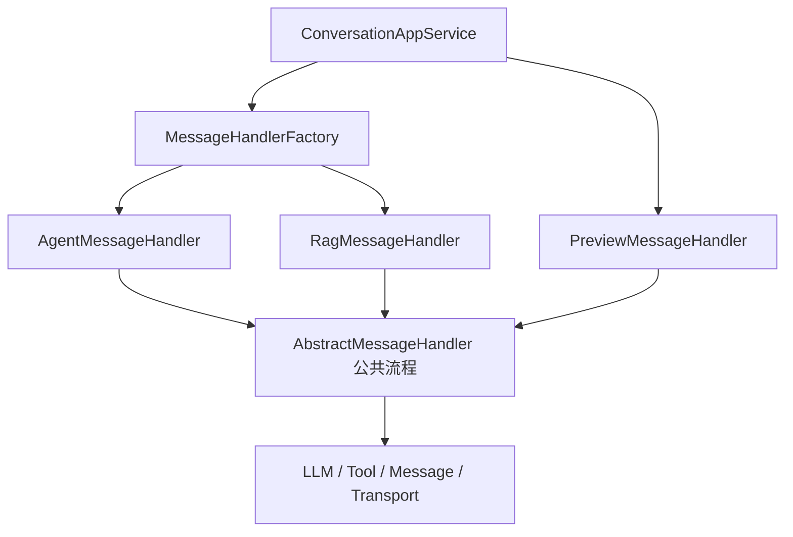

# 第 18 课：MessageHandler 机制（小白版）

## 这节课要解决什么问题

第 17 课讲到，`ConversationAppService` 准备好 `ChatContext` 后，会把请求交给消息处理器。

但 AgentX 里不是只有一种聊天：

- 普通 Agent 对话
- RAG 知识库对话
- Agent 创建/编辑时的预览对话
- Widget 嵌入网页对话

不同对话的处理方式不同。

所以项目里有：

```text
MessageHandler 机制。
```

## 本课学习目标

学完本课后，你应该能回答：

1. `MessageHandlerFactory` 是什么？
2. `AbstractMessageHandler` 负责什么？
3. `AgentMessageHandler` 负责什么？
4. `RagMessageHandler` 负责什么？
5. `PreviewMessageHandler` 为什么不保存消息？
6. 普通对话、RAG 对话、预览对话有什么区别？
7. 为什么要把公共流程放在父类里？

## 先用“医院分诊台”理解

你去医院看病，不是所有人都去同一个科室。

分诊台会根据情况分配：

| 症状 | 科室 |
| --- | --- |
| 牙疼 | 口腔科 |
| 眼睛不舒服 | 眼科 |
| 发烧 | 内科 |

AgentX 的消息处理也是这样。

`MessageHandlerFactory` 就像分诊台。

它根据请求类型或 Widget 类型，选择合适的处理器。

## MessageHandlerFactory：处理器分发器

文件位置：

```text
E:\agentx\AgentX\AgentX\src\main\java\org\xhy\application\conversation\service\handler\MessageHandlerFactory.java
```

核心逻辑：

```java
if (request instanceof RagChatRequest) {
    return applicationContext.getBean("ragMessageHandler", AbstractMessageHandler.class);
}

return applicationContext.getBean("agentMessageHandler", AbstractMessageHandler.class);
```

小白解释：

```text
如果是 RAG 请求，就找 RAG 处理器。
否则默认找普通 Agent 处理器。
```

Widget 也有类似判断：

```text
如果 Widget 是 RAG 类型，使用 RagMessageHandler。
否则使用 AgentMessageHandler。
```

## AbstractMessageHandler：公共流程父类

文件位置：

```text
E:\agentx\AgentX\AgentX\src\main\java\org\xhy\application\conversation\service\message\AbstractMessageHandler.java
```

它是很多处理器的父类。

你可以把它理解成：

```text
所有聊天处理器都要遵守的通用流程模板。
```

它的 `chat` 方法大概做这些事：

1. 创建连接。
2. 调用对话开始钩子。
3. 检查用户余额。
4. 创建用户消息和 AI 消息对象。
5. 初始化聊天内存。
6. 构建历史消息。
7. 准备工具。
8. 根据是否流式，选择流式或同步处理。

## 为什么公共流程放在父类

因为普通对话、RAG 对话、预览对话有很多相同步骤：

- 都要创建连接
- 都要拿模型
- 都要构建历史
- 都要调用模型
- 都要处理错误
- 都要发送消息

如果每个处理器都复制一份，代码会很乱。

所以公共流程放在 `AbstractMessageHandler`。

不同处理器只覆盖自己特殊的部分。

## AgentMessageHandler：普通 Agent 对话

文件位置：

```text
E:\agentx\AgentX\AgentX\src\main\java\org\xhy\application\conversation\service\message\agent\AgentMessageHandler.java
```

它主要负责：

```text
给普通 Agent 对话提供工具能力。
```

核心方法：

```java
protected ToolProvider provideTools(ChatContext chatContext)
```

里面会调用 `AgentToolManager`：

```text
根据 Agent 配置和当前用户，创建可用工具提供者。
```

小白理解：

```text
普通 Agent 不只是聊天，还可能会拿工具去做事。
```

## RagMessageHandler：知识库问答

文件位置：

```text
E:\agentx\AgentX\AgentX\src\main\java\org\xhy\application\conversation\service\message\RagMessageHandler.java
```

RAG 对话比普通聊天多一个步骤：

```text
先检索知识库，再让模型基于检索内容回答。
```

它的流程：

1. 发送“开始检索”消息。
2. 调用 `RAGSearchAppService` 检索文档。
3. 发送“检索完成”消息。
4. 把检索到的文档拼进提示词。
5. 调用模型生成回答。
6. 流式返回回答。

这就是为什么 RAG 有很多专门的 `MessageType`：

- `RAG_RETRIEVAL_START`
- `RAG_RETRIEVAL_END`
- `RAG_ANSWER_START`
- `RAG_ANSWER_PROGRESS`
- `RAG_ANSWER_END`

## PreviewMessageHandler：预览对话

文件位置：

```text
E:\agentx\AgentX\AgentX\src\main\java\org\xhy\application\conversation\service\message\preview\PreviewMessageHandler.java
```

预览用于：

```text
用户创建或编辑 Agent 时，先试一下效果。
```

它和普通对话最大的区别：

```text
不会保存消息到数据库。
```

为什么？

因为预览不是真正会话，只是试运行。

就像你买衣服前试穿，不会把试穿记录写进正式订单。

## 三种对话的区别

| 对话类型 | 处理器 | 特点 |
| --- | --- | --- |
| 普通 Agent 对话 | `AgentMessageHandler` | 使用 Agent 配置，可调用工具，保存消息 |
| RAG 对话 | `RagMessageHandler` | 先检索知识库，再基于资料回答 |
| 预览对话 | `PreviewMessageHandler` | 用虚拟 Agent 试效果，不保存消息 |

## AbstractMessageHandler 的流式处理

普通流式处理在父类中：

```text
processStreamingChat
processChat
```

大概过程：

1. 获取流式模型客户端。
2. 构建 LangChain4j 的 Agent。
3. 保存用户消息。
4. 启动 `TokenStream`。
5. 收到片段就发送给前端。
6. 完整回答后保存 AI 消息。
7. 发送结束消息。
8. 上报调用结果和计费。

## 工具调用消息

如果模型决定调用工具，会触发：

```text
onToolExecuted
```

系统会：

1. 如果前面已经有 AI 文本，先保存。
2. 创建一条 `TOOL_CALL` 消息。
3. 给前端发送“执行工具：xxx”。
4. 继续处理后续回答。

所以前端能看到类似：

```text
执行工具：search
```

## 处理器机制图



## 本课小结

这一课你要记住：

```text
MessageHandler 是真正处理聊天的地方，Factory 负责选谁来处理。
```

核心点：

- `MessageHandlerFactory` 负责分发
- `AbstractMessageHandler` 提供公共聊天模板
- `AgentMessageHandler` 处理普通 Agent 对话和工具
- `RagMessageHandler` 处理知识库检索后回答
- `PreviewMessageHandler` 处理预览，不保存正式消息
- 工具调用会生成 `TOOL_CALL` 消息

## 本课源码阅读路线

建议按这个顺序看：

1. `E:\agentx\AgentX\AgentX\src\main\java\org\xhy\application\conversation\service\handler\MessageHandlerFactory.java`
2. `E:\agentx\AgentX\AgentX\src\main\java\org\xhy\application\conversation\service\message\AbstractMessageHandler.java`
3. `E:\agentx\AgentX\AgentX\src\main\java\org\xhy\application\conversation\service\message\agent\AgentMessageHandler.java`
4. `E:\agentx\AgentX\AgentX\src\main\java\org\xhy\application\conversation\service\message\RagMessageHandler.java`
5. `E:\agentx\AgentX\AgentX\src\main\java\org\xhy\application\conversation\service\message\preview\PreviewMessageHandler.java`

## 课后练习

### 练习 1：选择处理器

如果是普通 Agent 聊天，默认使用哪个处理器？

参考答案：

```text
AgentMessageHandler。
```

### 练习 2：RAG 多了什么

RAG 对话相比普通对话，多了哪一步？

参考答案：

```text
先检索知识库，再基于检索结果生成回答。
```

## 下一课预告

下一课讲：

```text
LLM 调用封装。
```

我们会看 Provider、Model、ProviderProtocol、LangChain4j 和高可用降级。
