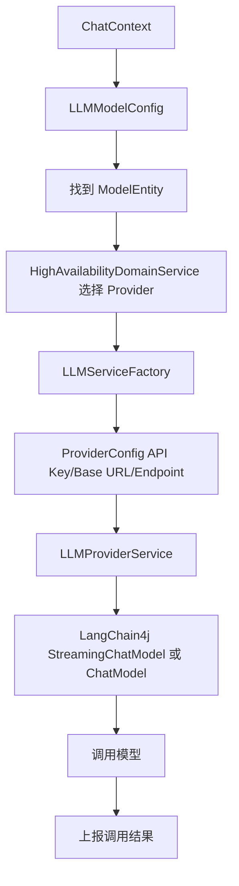

# 第 19 课：LLM 调用封装（小白版）

## 这节课要解决什么问题

Agent 最后要回答用户，离不开大模型。

但 AgentX 不是把某一个模型写死在代码里。

它把模型调用拆成几层：

```text
Provider -> Model -> ProviderProtocol -> LLMServiceFactory -> LangChain4j Client
```

这一课我们理解：

```text
AgentX 如何把不同模型服务商和模型调用统一封装起来。
```

## 本课学习目标

学完本课后，你应该能回答：

1. Provider 是什么？
2. Model 是什么？
3. ProviderProtocol 是什么？
4. `LLMModelConfig` 和 `ModelEntity` 有什么关系？
5. `LLMServiceFactory` 做什么？
6. 流式模型客户端和同步模型客户端有什么区别？
7. 高可用选择是什么意思？
8. 调用失败后为什么要上报结果？

## 先用“快递公司”理解

假设你要寄快递。

你可以选择：

- 顺丰
- 京东
- 中通

每个快递公司下面还有不同服务：

- 标准快递
- 次日达
- 国际件

在 AgentX 里：

| 快递场景 | AgentX |
| --- | --- |
| 快递公司 | Provider |
| 具体快递服务 | Model |
| 快递公司的接口规则 | ProviderProtocol |
| 帮你生成快递单的人 | LLMServiceFactory |

## Provider：模型服务商

Provider 对应源码：

```text
E:\agentx\AgentX\AgentX\src\main\java\org\xhy\domain\llm\model\ProviderEntity.java
```

它对应数据库表：

```text
providers
```

核心字段：

| 字段 | 小白解释 |
| --- | --- |
| `id` | 服务商 ID |
| `userId` | 属于哪个用户 |
| `protocol` | 使用什么协议 |
| `name` | 服务商名称 |
| `config` | API Key、Base URL 等配置 |
| `isOfficial` | 是否官方服务商 |
| `status` | 是否启用 |

Provider 可以理解成：

```text
模型服务供应商账号配置。
```

比如 OpenAI、Anthropic，或者兼容 OpenAI 协议的第三方服务。

## Model：具体模型

Model 对应源码：

```text
E:\agentx\AgentX\AgentX\src\main\java\org\xhy\domain\llm\model\ModelEntity.java
```

它对应数据库表：

```text
models
```

核心字段：

| 字段 | 小白解释 |
| --- | --- |
| `id` | 模型记录 ID |
| `providerId` | 属于哪个 Provider |
| `modelId` | 系统里的模型 ID |
| `name` | 模型显示名称 |
| `modelEndpoint` | 真正调用时的模型部署名称 |
| `type` | 模型类型 |
| `status` | 是否启用 |

Provider 和 Model 的关系：

```text
一个 Provider 下面可以有多个 Model。
```

比如一个服务商下面可能有：

- gpt-4.1
- gpt-4.1-mini
- text-embedding

## ProviderProtocol：协议类型

源码：

```text
E:\agentx\AgentX\AgentX\src\main\java\org\xhy\infrastructure\llm\protocol\enums\ProviderProtocol.java
```

当前有：

```text
OPENAI
ANTHROPIC
```

协议可以理解成：

```text
跟模型服务商说话的规则。
```

不同服务商的 API 格式可能不同。

AgentX 用 `ProviderProtocol` 判断应该按哪种协议创建客户端。

## LLMModelConfig：用户怎么用模型

上一阶段讲过：

```text
LLMModelConfig
```

它在 Agent 工作区里。

它保存：

- `modelId`
- `temperature`
- `topP`
- `topK`
- `maxTokens`
- 上下文处理策略

注意区分：

| 对象 | 小白解释 |
| --- | --- |
| `ModelEntity` | 系统里登记的某个模型 |
| `LLMModelConfig` | 用户使用 Agent 时选择哪个模型以及参数 |

一句话：

```text
ModelEntity 是菜单上的菜，LLMModelConfig 是用户这次点了哪道菜、口味怎么调。
```

## 聊天时如何确定模型

在 `ConversationAppService` 中：

```text
getModelForChat
```

会决定最终用哪个模型。

简化逻辑：

1. 如果外部请求指定了模型，就用指定模型。
2. 否则用工作区里的 `llmModelConfig.modelId`。
3. 如果还没有，就用用户默认模型。
4. 检查模型是否启用。

所以用户没有每次都选模型，也能聊天。

## 高可用选择 Provider

模型确定后，系统还会调用：

```text
highAvailabilityDomainService.selectBestProvider(...)
```

源码接口：

```text
E:\agentx\AgentX\AgentX\src\main\java\org\xhy\domain\llm\service\HighAvailabilityDomainService.java
```

你可以先这样理解：

```text
如果同一个模型有多个可用服务实例，系统尽量选择一个更可用的。
```

它返回：

```text
HighAvailabilityResult
```

里面包含：

- 最终 Provider
- 最终 Model
- instanceId

## 降级策略是什么意思

`ConversationAppService` 里还会读取：

```text
fallbackChain
```

也就是用户的降级模型链。

小白理解：

```text
如果首选模型不好用，就按备用列表尝试其他模型。
```

比如：

```text
首选模型 A -> 备用模型 B -> 备用模型 C
```

这能提高系统可用性。

## LLMServiceFactory 做什么

文件位置：

```text
E:\agentx\AgentX\AgentX\src\main\java\org\xhy\infrastructure\llm\LLMServiceFactory.java
```

它有两个关键方法：

```java
public StreamingChatModel getStreamingClient(ProviderEntity provider, ModelEntity model)

public ChatModel getStrandClient(ProviderEntity provider, ModelEntity model)
```

小白解释：

| 方法 | 用途 |
| --- | --- |
| `getStreamingClient` | 创建流式模型客户端 |
| `getStrandClient` | 创建同步模型客户端 |

它会把 Provider 的配置和 Model 的 endpoint 组装起来。

## LLMProviderService 和 LangChain4j

`LLMServiceFactory` 最后会调用：

```text
LLMProviderService.getStream
LLMProviderService.getStrand
```

文件位置：

```text
E:\agentx\AgentX\AgentX\src\main\java\org\xhy\infrastructure\llm\LLMProviderService.java
```

返回的是 LangChain4j 的客户端：

- `StreamingChatModel`
- `ChatModel`

LangChain4j 可以理解成：

```text
Java 里调用大模型的一套工具库。
```

AgentX 用它来统一调用模型、处理流式输出、工具调用等能力。

## 流式客户端和同步客户端

| 客户端 | 小白解释 | 使用场景 |
| --- | --- | --- |
| `StreamingChatModel` | 边生成边返回 | 页面聊天 |
| `ChatModel` | 生成完整答案后返回 | 同步 API |

普通页面聊天用流式客户端。

因为用户更喜欢看到字一点点出现。

同步接口适合程序调用：

```text
等完整结果出来后，一次性拿到答案。
```

## 调用结果上报

模型调用完成后，代码会调用：

```text
highAvailabilityDomainService.reportCallResult(...)
```

它会上报：

- instanceId
- modelId
- 是否成功
- 延迟时间
- 错误信息

为什么要上报？

因为高可用系统需要知道：

```text
哪个服务稳定，哪个服务经常失败，哪个服务响应慢。
```

下次选择 Provider 时，就可以更聪明。

## 模型调用流程图



## 本课小结

这一课你要记住：

```text
AgentX 没有把模型调用写死，而是用 Provider、Model、Protocol 和 Factory 把模型调用抽象起来。
```

核心点：

- Provider 是服务商配置
- Model 是具体模型
- ProviderProtocol 是调用协议
- LLMModelConfig 是用户使用模型的参数
- LLMServiceFactory 创建真正的模型客户端
- `StreamingChatModel` 用于流式聊天
- `ChatModel` 用于同步聊天
- 高可用服务负责选择更合适的 Provider
- 调用结果会上报，用于后续选择和降级

## 本课源码阅读路线

建议按这个顺序看：

1. `E:\agentx\AgentX\AgentX\src\main\java\org\xhy\domain\llm\model\ProviderEntity.java`
2. `E:\agentx\AgentX\AgentX\src\main\java\org\xhy\domain\llm\model\ModelEntity.java`
3. `E:\agentx\AgentX\AgentX\src\main\java\org\xhy\infrastructure\llm\protocol\enums\ProviderProtocol.java`
4. `E:\agentx\AgentX\AgentX\src\main\java\org\xhy\application\conversation\service\ConversationAppService.java`
5. `E:\agentx\AgentX\AgentX\src\main\java\org\xhy\domain\llm\service\HighAvailabilityDomainService.java`
6. `E:\agentx\AgentX\AgentX\src\main\java\org\xhy\infrastructure\llm\LLMServiceFactory.java`
7. `E:\agentx\AgentX\AgentX\src\main\java\org\xhy\infrastructure\llm\LLMProviderService.java`

## 课后练习

### 练习 1：解释 Provider 和 Model

请用一句话区分 Provider 和 Model。

参考答案：

```text
Provider 是模型服务商配置，Model 是这个服务商下面的具体模型。
```

### 练习 2：流式还是同步

页面聊天更适合用 `StreamingChatModel` 还是 `ChatModel`？

参考答案：

```text
StreamingChatModel，因为页面希望边生成边显示。
```

## 下一课预告

下一课讲：

```text
SSE 流式响应。
```

也就是模型生成的字，如何一点点推给前端。
