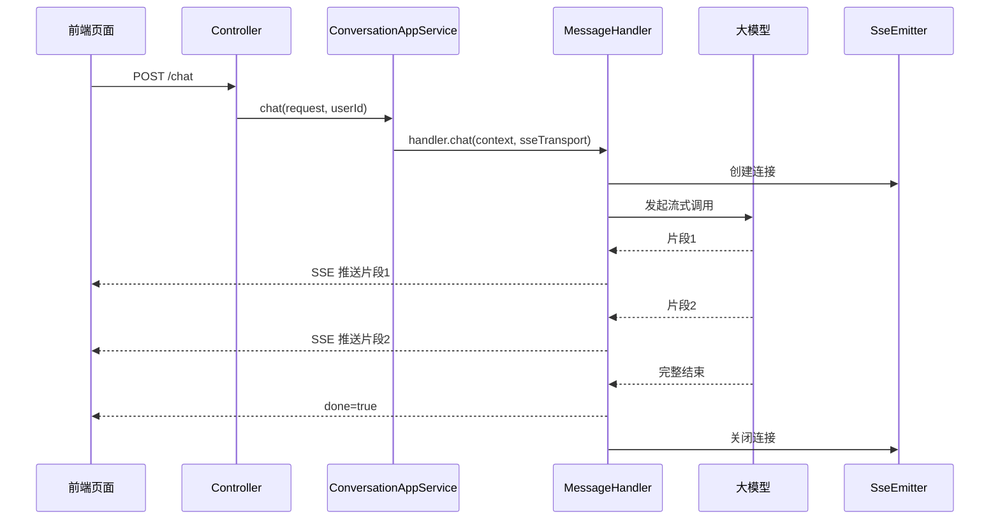

# 第 20 课：SSE 流式响应（小白版）

## 这节课要解决什么问题

你使用 ChatGPT 或 AgentX 聊天时，经常会看到回答不是一下子出现，而是一个字、一个词、一小段地出现。

这就是流式响应。

AgentX 里主要用：

```text
SSE + SseEmitter
```

这一课我们理解：

```text
模型输出如何实时返回前端，以及用户如何中断生成。
```

## 本课学习目标

学完本课后，你应该能回答：

1. SSE 是什么？
2. `SseEmitter` 是什么？
3. `MessageTransport` 为什么存在？
4. `SseMessageTransport` 如何发送消息？
5. `SyncMessageTransport` 和 SSE 有什么区别？
6. `AgentChatResponse.done` 是什么？
7. 前端为什么能实时显示模型回答？
8. 中断对话是怎么做的？

## 先用“直播”理解 SSE

普通接口像点外卖：

```text
你下单后，等很久，最后一次性拿到完整结果。
```

SSE 更像直播：

```text
主播说一句，你马上听到一句。
```

聊天流式响应也是：

```text
模型生成一点，后端推一点，前端显示一点。
```

## SSE 是什么

SSE 全称是：

```text
Server-Sent Events
```

可以先理解成：

```text
浏览器和服务器之间建立一条长连接，服务器可以不断往浏览器推消息。
```

它适合：

- AI 流式输出
- 进度通知
- 日志推送
- 状态更新

AgentX 的聊天流式输出就适合 SSE。

## SseEmitter 是什么

Spring Boot 里用：

```text
SseEmitter
```

来实现 SSE。

在接口层你会看到：

```java
public SseEmitter chat(@RequestBody @Validated ChatRequest chatRequest)
```

这表示：

```text
这个接口不会马上返回一个普通 JSON，而是返回一个可以持续推送消息的连接。
```

## 聊天接口返回 SseEmitter

聊天入口：

```text
E:\agentx\AgentX\AgentX\src\main\java\org\xhy\interfaces\api\portal\agent\PortalAgentSessionController.java
```

方法：

```java
@PostMapping("/chat")
public SseEmitter chat(@RequestBody @Validated ChatRequest chatRequest) {
    return conversationAppService.chat(chatRequest, UserContext.getCurrentUserId());
}
```

也就是说：

```text
前端发起聊天请求后，会拿到一条 SSE 连接。
```

后端通过这条连接不断推送模型输出。

## MessageTransport：传输抽象

文件位置：

```text
E:\agentx\AgentX\AgentX\src\main\java\org\xhy\infrastructure\transport\MessageTransport.java
```

它定义了统一方法：

```java
T createConnection(long timeout);
void sendMessage(T connection, AgentChatResponse response);
void sendEndMessage(T connection, AgentChatResponse response);
void completeConnection(T connection);
void handleError(T connection, Throwable error);
```

为什么要抽象？

因为系统以后可能支持不同传输方式：

- SSE
- WebSocket
- 同步返回

业务代码不想关心底层到底是哪种传输。

所以统一成 `MessageTransport`。

## MessageTransportFactory：选择传输方式

文件位置：

```text
E:\agentx\AgentX\AgentX\src\main\java\org\xhy\infrastructure\transport\MessageTransportFactory.java
```

它支持：

| 类型 | 实现 |
| --- | --- |
| `sse` | `SseMessageTransport` |
| `sync` | `SyncMessageTransport` |
| `websocket` | 预留 |

普通聊天用：

```text
sse
```

同步 API 用：

```text
sync
```

## SseMessageTransport 如何发送

文件位置：

```text
E:\agentx\AgentX\AgentX\src\main\java\org\xhy\infrastructure\transport\SseMessageTransport.java
```

创建连接：

```java
public SseEmitter createConnection(long timeout) {
    SseEmitter emitter = new SseEmitter(timeout);
    return emitter;
}
```

发送普通片段：

```java
public void sendMessage(SseEmitter connection, AgentChatResponse response) {
    safeSendMessage(connection, response);
}
```

发送结束消息：

```java
public void sendEndMessage(SseEmitter connection, AgentChatResponse response) {
    safeSendMessage(connection, response);
    safeCompleteEmitter(connection);
}
```

小白解释：

```text
sendMessage 是“继续说”。
sendEndMessage 是“说完了，关闭连接”。
```

## AgentChatResponse 是前端收到的消息

流式返回的数据对象是：

```text
AgentChatResponse
```

它常见字段包括：

| 字段 | 小白解释 |
| --- | --- |
| `content` | 这次推送的内容 |
| `done` | 是否结束 |
| `messageType` | 消息类型 |
| `timestamp` | 时间戳 |
| `payload` | 额外数据 |

其中 `done` 很重要：

| done | 含义 |
| --- | --- |
| `false` | 还没结束，继续等后续消息 |
| `true` | 本段或本次消息结束 |

## 模型片段如何推给前端

在 `AbstractMessageHandler` 的流式处理中，会启动 `TokenStream`。

当模型返回一个片段时，会触发：

```text
onPartialResponse
```

系统会：

```java
transport.sendMessage(connection, AgentChatResponse.build(reply, MessageType.TEXT));
```

也就是：

```text
模型每生成一小段，后端就通过 SSE 推给前端。
```

当模型完整回答结束，会触发：

```text
onCompleteResponse
```

系统会：

1. 保存 AI 完整消息。
2. 发送结束消息。
3. 关闭 SSE 连接。
4. 上报调用结果。
5. 执行计费。

## SyncMessageTransport：同步传输

文件位置：

```text
E:\agentx\AgentX\AgentX\src\main\java\org\xhy\infrastructure\transport\SyncMessageTransport.java
```

它不是一段段推给前端。

它会把内容累积到一个 `ChatResponse` 里。

小白理解：

```text
SSE 是边做边端上桌。
Sync 是全部做完再端上桌。
```

## 中断对话入口

用户点击“停止生成”时，会调用：

```text
POST /agents/sessions/{sessionId}/interrupt
```

入口在：

```text
E:\agentx\AgentX\AgentX\src\main\java\org\xhy\interfaces\api\portal\agent\PortalAgentSessionController.java
```

它会调用：

```text
chatSessionManager.interruptSession(sessionId)
```

## ChatSessionManager：管理正在生成的会话

文件位置：

```text
E:\agentx\AgentX\AgentX\src\main\java\org\xhy\application\conversation\service\ChatSessionManager.java
```

它内部维护：

```text
activeSessions
```

也就是正在进行中的聊天连接。

聊天开始后注册：

```java
chatSessionManager.registerSession(sessionId, emitter);
```

中断时：

1. 找到这个 `sessionId` 对应的连接。
2. 设置中断标记。
3. 发送 interrupt 事件。
4. 关闭 SSE 连接。
5. 从活跃会话里移除。

## SSE 流式流程图



## 前端如何消费流式结果

课程不深入前端代码，但你可以先这样理解：

```text
前端发起请求后，不断监听后端推来的消息。
```

每收到一个 `content`：

```text
就追加到聊天气泡里。
```

如果收到 `done=true`：

```text
就认为这次回答结束。
```

如果收到 `messageType=TOOL_CALL`：

```text
就可以显示“正在执行工具”之类的提示。
```

## 本课小结

这一课你要记住：

```text
SSE 让后端可以把模型生成的内容一点点推给前端。
```

核心点：

- `SseEmitter` 是 Spring Boot 的 SSE 连接对象
- `MessageTransport` 抽象了传输方式
- `SseMessageTransport` 负责 SSE 推送
- `sendMessage` 表示发送中间片段
- `sendEndMessage` 表示发送结束并关闭
- `SyncMessageTransport` 负责同步返回
- `AgentChatResponse` 是前端收到的消息格式
- `ChatSessionManager` 管理正在生成的会话
- 中断对话会关闭对应 SSE 连接

## 本课源码阅读路线

建议按这个顺序看：

1. `E:\agentx\AgentX\AgentX\src\main\java\org\xhy\interfaces\api\portal\agent\PortalAgentSessionController.java`
2. `E:\agentx\AgentX\AgentX\src\main\java\org\xhy\infrastructure\transport\MessageTransport.java`
3. `E:\agentx\AgentX\AgentX\src\main\java\org\xhy\infrastructure\transport\MessageTransportFactory.java`
4. `E:\agentx\AgentX\AgentX\src\main\java\org\xhy\infrastructure\transport\SseMessageTransport.java`
5. `E:\agentx\AgentX\AgentX\src\main\java\org\xhy\infrastructure\transport\SyncMessageTransport.java`
6. `E:\agentx\AgentX\AgentX\src\main\java\org\xhy\application\conversation\service\message\AbstractMessageHandler.java`
7. `E:\agentx\AgentX\AgentX\src\main\java\org\xhy\application\conversation\service\ChatSessionManager.java`

## 课后练习

### 练习 1：解释 SSE

请用一句话解释：

```text
SSE 是什么？
```

参考答案：

```text
SSE 是服务器通过一条长连接不断向前端推送消息的机制。
```

### 练习 2：sendMessage 和 sendEndMessage

请区分：

```text
sendMessage 和 sendEndMessage 有什么区别？
```

参考答案：

```text
sendMessage 发送中间片段，sendEndMessage 发送结束消息并关闭连接。
```

## 下一阶段预告

从第 21 课开始，我们进入：

```text
Agent 增强能力。
```

也就是工具调用、MCP、RAG、向量检索这些真正让 Agent 变强的能力。
