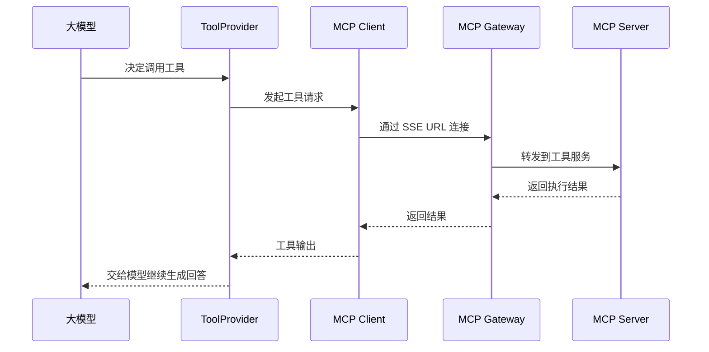

# 第 22 课：MCP 集成机制（小白版）

## 这节课要解决什么问题

上一课我们知道：

```text
工具让 Agent 会做事。
```

但工具不一定直接运行在后端代码里。

很多工具是外部服务，需要通过一种协议来调用。

AgentX 里重要的一种方式是：

```text
MCP。
```

这一课我们理解：

```text
AgentX 后端如何找到 MCP 工具、连接 MCP Server，并把工具能力交给大模型。
```

## 本课学习目标

学完本课后，你应该能回答：

1. MCP 可以先怎么理解？
2. MCP Server 是什么？
3. MCP Gateway 是什么？
4. 为什么需要容器？
5. 用户工具和全局工具有什么区别？
6. `McpUrlProviderService` 做什么？
7. `AgentToolManager` 如何创建 MCP Client？
8. 工具输入输出如何回到模型？

## 先用“插座转接头”理解 MCP

不同电器的插头可能不一样。

如果插座不匹配，你需要转接头。

MCP 就像工具调用领域的转接规范。

它让 Agent 可以用相对统一的方式调用外部工具。

小白先记住：

```text
MCP 是 Agent 和外部工具之间的一套通信规则。
```

## MCP Server 是什么

MCP Server 可以理解成：

```text
真正提供工具能力的服务。
```

比如一个 MCP Server 可能提供：

- 搜索工具
- 文件读取工具
- 数据库查询工具
- 浏览器操作工具

Agent 不是直接知道这些工具怎么实现。

它通过 MCP Client 连接 MCP Server，再发起工具调用。

## MCP Gateway 是什么

MCP Gateway 可以理解成：

```text
工具服务的入口和路由层。
```

AgentX 里有：

```text
E:\agentx\AgentX\AgentX\src\main\java\org\xhy\infrastructure\mcp_gateway\MCPGatewayService.java
```

它负责构建工具连接 URL、部署工具等事情。

你可以把它理解成：

```text
用户说要找某个工具，MCP Gateway 帮你找到对应入口。
```

## 为什么需要容器

很多工具需要独立运行环境。

比如工具可能需要：

- 特定依赖
- 命令行环境
- 隔离的文件系统
- 独立网络

所以 AgentX 使用容器来承载工具运行环境。

容器相关接口在：

```text
E:\agentx\AgentX\AgentX\src\main\java\org\xhy\interfaces\api\admin\AdminContainerController.java
```

管理员可以：

- 查看容器
- 启动容器
- 停止容器
- 查看日志
- 检查 MCP Gateway 状态
- 创建审核容器

## 用户容器和审核容器

在 `McpUrlProviderService` 里，有两条路径：

| 工具类型 | 使用容器 |
| --- | --- |
| 用户工具 | 用户自己的容器 |
| 全局工具 | 审核容器 |

为什么要区分？

因为用户工具要隔离。

不同用户安装的工具、运行环境、权限都可能不同。

全局工具则可以由平台统一维护。

## McpUrlProviderService：工具 URL 提供者

源码：

```text
E:\agentx\AgentX\AgentX\src\main\java\org\xhy\application\conversation\service\McpUrlProviderService.java
```

核心方法：

```java
public String getMcpToolUrl(String mcpServerName, String userId)
```

它会：

1. 判断工具是全局工具还是用户工具。
2. 如果是全局工具，使用审核容器。
3. 如果是用户工具，准备用户容器。
4. 检查容器是否运行正常。
5. 构建 MCP SSE URL。
6. 必要时部署工具。
7. 返回工具连接地址。

一句话：

```text
McpUrlProviderService 负责把工具名变成可连接的 MCP 地址。
```

## 工具连接 URL 是怎么来的

用户工具流程简化：

```text
mcpServerName + userId
-> 找工具类型
-> 确保用户容器运行
-> 用 MCPGatewayService 拼出 SSE URL
-> 部署工具
-> 返回 URL
```

全局工具流程简化：

```text
mcpServerName
-> 确保审核容器运行
-> 用 MCPGatewayService 拼出 SSE URL
-> 返回 URL
```

## AgentToolManager 如何连接 MCP

源码：

```text
E:\agentx\AgentX\AgentX\src\main\java\org\xhy\application\conversation\service\message\agent\AgentToolManager.java
```

它会：

1. 遍历 `mcpServerNames`。
2. 调用 `mcpUrlProviderService.getMcpToolUrl(...)`。
3. 创建 `HttpMcpTransport`。
4. 创建 `DefaultMcpClient`。
5. 加入预设参数。
6. 通过 `McpToolProvider` 生成 `ToolProvider`。

简单理解：

```text
AgentToolManager 拿到工具地址后，帮模型接上线。
```

## MCP 通信为什么用 SSE

代码里会创建：

```text
HttpMcpTransport.Builder().sseUrl(sseUrl)
```

SSE 是一种长连接。

适合工具服务持续返回状态或结果。

这和第 20 课的聊天流式响应类似：

```text
都是服务端可以持续推送消息。
```

## 工具预设参数如何传入 MCP

如果 Agent 配置了 `toolPresetParams`，`AgentToolManager` 会把它变成：

```text
PresetParameter
```

然后设置给 `mcpClient`。

这代表：

```text
工具调用前，某些参数已经提前固定。
```

比如：

- 固定项目 ID
- 固定数据源
- 固定环境

这样模型调用工具时更稳定。

## 工具调用结果如何回传

简化流程：



你可以理解成：

```text
模型提需求，工具执行，结果回给模型，模型再回复用户。
```

## Docker 容器管理在哪里

容器领域模型在：

```text
E:\agentx\AgentX\AgentX\src\main\java\org\xhy\domain\container
```

Docker 服务在：

```text
E:\agentx\AgentX\AgentX\src\main\java\org\xhy\infrastructure\docker\DockerService.java
```

容器配置在：

```text
E:\agentx\AgentX\AgentX\src\main\java\org\xhy\infrastructure\config\ContainerConfig.java
```

这一课不用深入 Docker 实现。

先知道：

```text
工具运行环境由容器承载，后端负责创建、启动、停止和健康检查。
```

## 本课小结

这一课你要记住：

```text
MCP 是 Agent 调用外部工具的通信规则，容器提供工具运行环境，MCP Gateway 提供连接入口。
```

核心点：

- MCP Server 提供实际工具能力
- MCP Gateway 负责工具入口和路由
- 用户工具使用用户容器
- 全局工具使用审核容器
- `McpUrlProviderService` 把工具名转成 SSE URL
- `AgentToolManager` 创建 MCP Client 和 `ToolProvider`
- 工具结果会回到模型，再由模型整理给用户

## 本课源码阅读路线

1. `E:\agentx\AgentX\AgentX\src\main\java\org\xhy\application\conversation\service\McpUrlProviderService.java`
2. `E:\agentx\AgentX\AgentX\src\main\java\org\xhy\application\conversation\service\message\agent\AgentToolManager.java`
3. `E:\agentx\AgentX\AgentX\src\main\java\org\xhy\infrastructure\mcp_gateway\MCPGatewayService.java`
4. `E:\agentx\AgentX\AgentX\src\main\java\org\xhy\interfaces\api\admin\AdminContainerController.java`
5. `E:\agentx\AgentX\AgentX\src\main\java\org\xhy\domain\container\model\ContainerEntity.java`
6. `E:\agentx\AgentX\AgentX\src\main\java\org\xhy\infrastructure\docker\DockerService.java`

## 课后练习

### 练习 1：解释 MCP

参考答案：

```text
MCP 是 Agent 和外部工具之间的一套通信规则，让模型能用统一方式调用工具。
```

### 练习 2：解释 McpUrlProviderService

参考答案：

```text
它负责根据工具名和用户 ID 准备容器，并返回可以连接工具的 MCP SSE URL。
```

## 下一课预告

下一课讲：

```text
RAG 知识库基础。
```

也就是文件如何变成 Agent 可以检索的知识。
