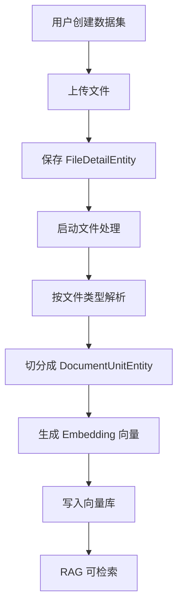

# 第 23 课：RAG 知识库基础（小白版）

## 这节课要解决什么问题

大模型本身不一定知道你的私有资料。

比如：

- 公司内部制度
- 产品说明书
- 客服 FAQ
- 项目文档
- 课程资料

如果希望 Agent 根据这些资料回答，就需要：

```text
RAG 知识库。
```

这一课先讲：

```text
文件如何变成可以检索的知识。
```

## 本课学习目标

学完本课后，你应该能回答：

1. RAG 是什么？
2. 数据集是什么？
3. 文件上传后保存在哪里？
4. 文档片段是什么？
5. 为什么要切分文档？
6. Embedding 是什么？
7. 向量库保存什么？
8. 知识库和 Agent 如何绑定？

## 先用“图书馆”理解 RAG

RAG 可以先理解成：

```text
让 AI 先去资料库查资料，再根据查到的资料回答。
```

像图书馆：

1. 你把书放进图书馆。
2. 图书馆给书分类、建索引。
3. 读者提问。
4. 图书管理员先找相关书页。
5. 再根据书页回答。

AgentX 的 RAG 也是类似：

| 图书馆 | AgentX |
| --- | --- |
| 图书馆 | 数据集 |
| 一本书 | 文件 |
| 一页或一段 | 文档片段 |
| 索引 | 向量 |
| 查资料 | 检索 |
| 根据资料回答 | RAG 回答 |

## 数据集是什么

数据集实体：

```text
E:\agentx\AgentX\AgentX\src\main\java\org\xhy\domain\rag\model\RagQaDatasetEntity.java
```

对应表：

```text
ai_rag_qa_dataset
```

核心字段：

| 字段 | 小白解释 |
| --- | --- |
| `id` | 数据集 ID |
| `name` | 数据集名称 |
| `icon` | 图标 |
| `description` | 描述 |
| `userId` | 创建者 |

你可以把数据集理解成：

```text
一个知识库文件夹。
```

## 数据集接口在哪里

接口在：

```text
E:\agentx\AgentX\AgentX\src\main\java\org\xhy\interfaces\api\portal\rag\RagQaDatasetController.java
```

主要接口：

| 接口 | 小白解释 |
| --- | --- |
| `POST /rag/datasets` | 创建数据集 |
| `GET /rag/datasets` | 查询数据集 |
| `POST /rag/datasets/files` | 上传文件 |
| `POST /rag/datasets/files/process` | 启动文件处理 |
| `GET /rag/datasets/files/{fileId}/progress` | 查看文件处理进度 |

## FileDetailEntity：文件信息

文件实体：

```text
E:\agentx\AgentX\AgentX\src\main\java\org\xhy\domain\rag\model\FileDetailEntity.java
```

它保存：

| 字段 | 小白解释 |
| --- | --- |
| `id` | 文件 ID |
| `url` | 文件访问地址 |
| `filename` | 文件名 |
| `originalFilename` | 原始文件名 |
| `ext` | 扩展名 |
| `contentType` | 文件类型 |
| `userId` | 上传用户 |
| `dataSetId` | 属于哪个数据集 |
| `filePageSize` | 总页数 |
| `processingStatus` | 处理状态 |
| `ocrProcessProgress` | OCR 处理进度 |
| `embeddingProcessProgress` | 向量化进度 |

你可以理解成：

```text
FileDetailEntity 是上传文件的档案。
```

## 文档为什么要切分

大模型和向量检索都不适合直接处理一本完整的大文档。

所以系统会把文件切成小块。

比如一个 100 页 PDF，可以切成：

```text
第 1 页片段
第 2 页片段
第 3 页片段
...
```

或者按段落切。

这样检索时可以更精确：

```text
不用整本书都拿出来，只拿最相关的几段。
```

## DocumentUnitEntity：文档片段

文档片段实体：

```text
E:\agentx\AgentX\AgentX\src\main\java\org\xhy\domain\rag\model\DocumentUnitEntity.java
```

对应字段：

| 字段 | 小白解释 |
| --- | --- |
| `id` | 文档片段 ID |
| `fileId` | 来自哪个文件 |
| `page` | 页码 |
| `content` | 片段内容 |
| `isVector` | 是否已向量化 |
| `isOcr` | 是否 OCR 识别 |
| `similarityScore` | 搜索相似度分数 |

你可以理解成：

```text
DocumentUnitEntity 是一本书里被切出来的一页或一段。
```

## 文件处理策略

不同文件类型处理方式不同。

相关目录：

```text
E:\agentx\AgentX\AgentX\src\main\java\org\xhy\domain\rag\strategy
```

里面有：

- `PDFRagDocDocumentProcessing`
- `WORDDocumentProcessing`
- `MarkdownRagDocumentProcessing`
- `TXTRagDocDocumentProcessing`

这说明系统会根据文件类型选择不同解析策略。

小白理解：

```text
PDF、Word、Markdown、TXT 读法不同，所以需要不同处理器。
```

## Embedding 是什么

Embedding 可以理解成：

```text
把文字变成一串数字，让计算机能比较语义相似度。
```

比如：

```text
“请假制度”
“员工休假流程”
```

字面不完全一样，但意思接近。

向量可以帮助系统判断它们相关。

## 向量存储在哪里

向量相关服务：

```text
E:\agentx\AgentX\AgentX\src\main\java\org\xhy\domain\rag\service\EmbeddingDomainService.java
```

它会把 `DocumentUnitEntity` 的内容变成向量，再存入向量存储。

项目里也有：

```text
VectorStoreRepository
```

用于检索向量库里的文本。

你可以先理解为：

```text
向量库存的是“文本片段 + 它的数字指纹 + 元数据”。
```

## 文件到知识库的流程



## 知识库和 Agent 的绑定

第 11 课讲过，Agent 里有：

```text
knowledgeBaseIds
```

它表示：

```text
这个 Agent 关联哪些知识库。
```

当 Agent 进行 RAG 对话时，系统会根据这些 ID 去检索对应数据集。

所以：

```text
上传文件只是准备资料，绑定到 Agent 后才会参与 Agent 回答。
```

## 本课小结

这一课你要记住：

```text
RAG 的基础流程是：文件上传 -> 文档解析 -> 切分片段 -> 向量化 -> 检索回答。
```

核心点：

- 数据集是知识库文件夹
- 文件信息保存在 `FileDetailEntity`
- 文档片段保存在 `DocumentUnitEntity`
- Embedding 把文本变成向量
- 向量库用于语义检索
- Agent 通过 `knowledgeBaseIds` 绑定知识库

## 本课源码阅读路线

1. `E:\agentx\AgentX\AgentX\src\main\java\org\xhy\interfaces\api\portal\rag\RagQaDatasetController.java`
2. `E:\agentx\AgentX\AgentX\src\main\java\org\xhy\domain\rag\model\RagQaDatasetEntity.java`
3. `E:\agentx\AgentX\AgentX\src\main\java\org\xhy\domain\rag\model\FileDetailEntity.java`
4. `E:\agentx\AgentX\AgentX\src\main\java\org\xhy\domain\rag\model\DocumentUnitEntity.java`
5. `E:\agentx\AgentX\AgentX\src\main\java\org\xhy\domain\rag\strategy`
6. `E:\agentx\AgentX\AgentX\src\main\java\org\xhy\domain\rag\service\EmbeddingDomainService.java`

## 课后练习

### 练习 1：解释 RAG

参考答案：

```text
RAG 是让 AI 先从知识库检索相关资料，再基于资料回答问题。
```

### 练习 2：解释 DocumentUnit

参考答案：

```text
DocumentUnit 是从文件中切出来的一个文档片段，用于后续向量化和检索。
```

## 下一课预告

下一课讲：

```text
RAG 检索流程。
```

我们会看用户问题如何找到相关文档片段。
