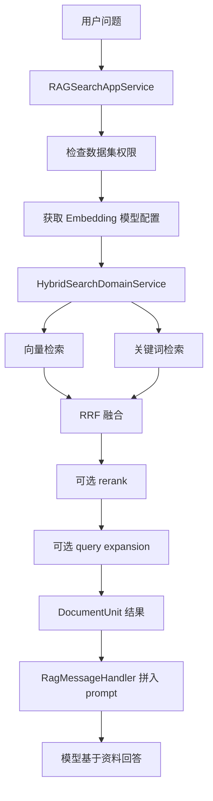

# 第 24 课：RAG 检索流程（小白版）

## 这节课要解决什么问题

第 23 课讲了文件如何变成知识库。

这一课继续看：

```text
用户提问后，系统如何从知识库里找出相关资料？
```

这一步叫：

```text
检索。
```

## 本课学习目标

学完本课后，你应该能回答：

1. 向量检索是什么？
2. 关键词检索是什么？
3. 混合检索是什么？
4. RRF 融合是什么？
5. rerank 是什么？
6. query expansion 是什么？
7. 检索结果如何进入 prompt？
8. `RagMessageHandler` 和检索有什么关系？

## 先用“搜索图书馆”理解

用户问：

```text
公司年假怎么申请？
```

系统要在知识库里找资料。

有两种找法：

1. 看字面关键词：年假、申请。
2. 看语义相似：休假流程、请假制度。

只用关键词可能漏掉同义表达。

只用语义也可能不够精确。

所以 AgentX 使用：

```text
混合检索。
```

## 检索入口在哪里

RAG 搜索接口在：

```text
E:\agentx\AgentX\AgentX\src\main\java\org\xhy\interfaces\api\portal\rag\RagSearchController.java
```

应用服务：

```text
E:\agentx\AgentX\AgentX\src\main\java\org\xhy\application\rag\service\search\RAGSearchAppService.java
```

核心方法：

```java
public List<DocumentUnitDTO> ragSearch(RagSearchRequest request, String userId)
```

它会：

1. 检查用户是否有权限访问数据集。
2. 获取用户的嵌入模型配置。
3. 获取聊天模型配置。
4. 构造 `HybridSearchConfig`。
5. 调用 `HybridSearchDomainService.hybridSearch`。
6. 返回文档片段 DTO。

## 向量检索是什么

向量检索由：

```text
EmbeddingDomainService.vectorSearch
```

负责。

它会：

1. 用 Embedding 模型把用户问题变成向量。
2. 在向量库里找语义相似的文档片段。
3. 返回相似度较高的结果。

小白理解：

```text
向量检索不是只看字面，而是看意思像不像。
```

比如：

```text
“如何请假”
```

可能找到：

```text
“员工休假申请流程”
```

哪怕两个句子没有完全相同的词。

## 关键词检索是什么

关键词检索在：

```text
E:\agentx\AgentX\AgentX\src\main\java\org\xhy\domain\rag\repository\VectorStoreRepository.java
```

它使用 PostgreSQL 全文搜索：

```text
to_tsvector
to_tsquery
ts_rank_cd
```

小白理解：

```text
关键词检索更像传统搜索，看文字中是否出现相关词。
```

比如用户问“报销发票”，关键词检索会特别关注包含“报销”“发票”的片段。

## 混合检索是什么

混合检索服务：

```text
E:\agentx\AgentX\AgentX\src\main\java\org\xhy\domain\rag\service\HybridSearchDomainService.java
```

它会并行执行：

```text
向量检索 + 关键词检索
```

然后融合结果。

为什么要混合？

| 检索方式 | 优点 | 缺点 |
| --- | --- | --- |
| 向量检索 | 理解语义 | 有时不够精确 |
| 关键词检索 | 关键词精准 | 不懂同义表达 |
| 混合检索 | 兼顾语义和关键词 | 实现更复杂 |

## RRF 融合是什么

RRF 全称是：

```text
Reciprocal Rank Fusion
```

你不用背公式。

先这样理解：

```text
把向量检索和关键词检索的排名合并成一个综合排名。
```

如果一个文档在两个列表里都排得靠前，它就更可能排到最终结果前面。

代码里有：

```text
fusionWithRRF
```

这就是融合排序。

## rerank 是什么

rerank 可以理解成：

```text
先粗搜一批候选结果，再重新精排。
```

比如先找出 30 个可能相关片段。

然后让更精细的排序模型重新判断：

```text
哪些最应该放到前面？
```

这样最终给模型的资料更准。

## query expansion 是什么

query expansion 可以理解成：

```text
检索到某个片段后，顺便把它附近的片段也带上。
```

因为一个答案可能跨越前后几段。

如果只拿命中的那一段，可能缺上下文。

所以系统可以扩展相邻片段。

## HyDE 是什么

代码里还有：

```text
HyDEDomainService
```

HyDE 可以先理解为：

```text
先根据用户问题生成一个假想答案或假想文档，再用它去做向量检索。
```

这样有时能更好地找到相关资料。

不必现在深入，只需要知道：

```text
它是提升检索质量的一种增强手段。
```

## 检索结果如何进入 prompt

在第 18 课里，`RagMessageHandler` 会先执行 RAG 检索。

源码：

```text
E:\agentx\AgentX\AgentX\src\main\java\org\xhy\application\conversation\service\message\RagMessageHandler.java
```

它会：

1. 发送“开始检索”消息。
2. 调用 `RAGSearchAppService`。
3. 得到相关文档片段。
4. 把片段放进 RAG 专用提示词。
5. 要求模型只能基于这些资料回答。

这就是：

```text
检索增强生成。
```

## RAG 检索完整流程图



## 本课小结

这一课你要记住：

```text
RAG 检索就是从知识库里找到最相关的文档片段，再交给模型回答。
```

核心点：

- 向量检索看语义相似度
- 关键词检索看字面相关性
- 混合检索同时使用两者
- RRF 融合多个检索结果排名
- rerank 重新精排候选结果
- query expansion 补充相邻上下文
- `RagMessageHandler` 把检索结果放进 prompt

## 本课源码阅读路线

1. `E:\agentx\AgentX\AgentX\src\main\java\org\xhy\interfaces\api\portal\rag\RagSearchController.java`
2. `E:\agentx\AgentX\AgentX\src\main\java\org\xhy\application\rag\service\search\RAGSearchAppService.java`
3. `E:\agentx\AgentX\AgentX\src\main\java\org\xhy\domain\rag\service\EmbeddingDomainService.java`
4. `E:\agentx\AgentX\AgentX\src\main\java\org\xhy\domain\rag\repository\VectorStoreRepository.java`
5. `E:\agentx\AgentX\AgentX\src\main\java\org\xhy\domain\rag\service\HybridSearchDomainService.java`
6. `E:\agentx\AgentX\AgentX\src\main\java\org\xhy\application\conversation\service\message\RagMessageHandler.java`

## 课后练习

### 练习 1：区分两种检索

参考答案：

```text
向量检索看语义相似，关键词检索看文字关键词匹配。
```

### 练习 2：解释混合检索

参考答案：

```text
混合检索是同时使用向量检索和关键词检索，再把结果融合排序。
```

## 下一课预告

下一课讲：

```text
长期记忆机制。
```

它和 RAG 很像，都用向量检索，但保存的是用户偏好和长期有用的信息。
