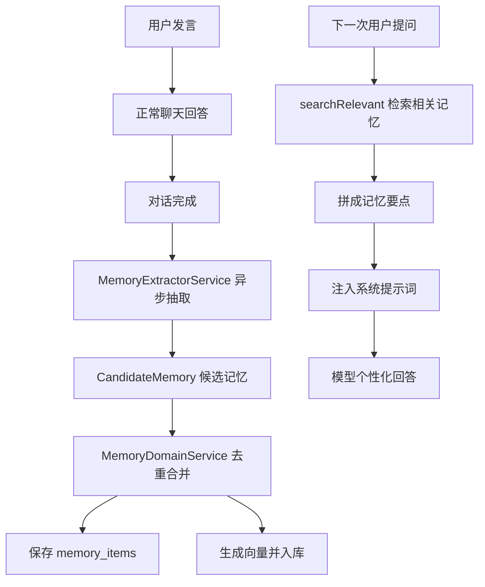

# 第 25 课：长期记忆机制（小白版）

## 这节课要解决什么问题

RAG 让 Agent 能查资料。

长期记忆让 Agent 能记住用户。

比如用户说：

```text
以后都用简体中文回答，并尽量给出 bash 示例。
```

这不是一次性问题。

它对以后很多轮对话都有帮助。

AgentX 会尝试把这种信息保存成长期记忆。

## 本课学习目标

学完本课后，你应该能回答：

1. 长期记忆是什么？
2. 长期记忆和 RAG 有什么区别？
3. CandidateMemory 是什么？
4. MemoryItemEntity 保存什么？
5. dedupeHash 是什么？
6. importance 是什么？
7. 记忆如何向量化？
8. 记忆如何注入对话上下文？

## 先用“熟悉你的助理”理解

一个真正熟悉你的助理，会记住：

- 你喜欢中文回答
- 你常用 Windows
- 你正在学习 AgentX
- 你希望解释得小白一点

这些不是知识库文档，而是关于“你”的长期信息。

所以：

```text
RAG 记资料，长期记忆记用户。
```

## 长期记忆和 RAG 的区别

| 对比项 | RAG 知识库 | 长期记忆 |
| --- | --- | --- |
| 保存对象 | 文档资料 | 用户偏好、事实、目标 |
| 来源 | 上传文件 | 用户对话 |
| 粒度 | 文档片段 | 记忆条目 |
| 隔离 | 数据集权限 | 用户隔离 |
| 用途 | 查资料回答 | 个性化回答 |

一句话：

```text
RAG 像资料库，长期记忆像助理对你的了解。
```

## CandidateMemory：候选记忆

源码：

```text
E:\agentx\AgentX\AgentX\src\main\java\org\xhy\domain\memory\model\CandidateMemory.java
```

它是“准备保存的记忆候选”。

字段：

| 字段 | 小白解释 |
| --- | --- |
| `type` | 记忆类型 |
| `text` | 记忆内容 |
| `importance` | 重要程度 |
| `tags` | 标签 |
| `data` | 附加数据 |

为什么叫候选？

因为不是用户说的每句话都值得记住。

系统会先抽取候选，再决定保存。

## MemoryType：记忆类型

代码里有几类记忆：

| 类型 | 小白解释 |
| --- | --- |
| `PROFILE` | 用户稳定偏好 |
| `TASK` | 中长期目标 |
| `FACT` | 较稳定事实 |
| `EPISODIC` | 短期但有帮助的情节 |

例如：

| 用户说的话 | 可能类型 |
| --- | --- |
| 以后用中文回答 | `PROFILE` |
| 这周要学完 AgentX | `TASK` |
| 我主要用 Python | `FACT` |
| 接下来几轮都围绕 Docker 问题 | `EPISODIC` |

## MemoryExtractorService：记忆抽取器

源码：

```text
E:\agentx\AgentX\AgentX\src\main\java\org\xhy\domain\memory\service\MemoryExtractorService.java
```

它会在对话完成后异步运行：

```java
extractAndPersistAsync(userId, sessionId, userMessage)
```

它的任务是：

```text
从用户当轮发言里提取长期有用的信息。
```

注意它的规则很严格：

- 一次性命令不记
- 临时细节不记
- 隐私和密钥不记
- 只有有复用价值的内容才记
- 重要性足够高才记

## MemoryItemEntity：正式记忆条目

源码：

```text
E:\agentx\AgentX\AgentX\src\main\java\org\xhy\domain\memory\model\MemoryItemEntity.java
```

对应表：

```text
memory_items
```

核心字段：

| 字段 | 小白解释 |
| --- | --- |
| `id` | 记忆 ID |
| `userId` | 属于哪个用户 |
| `type` | 记忆类型 |
| `text` | 记忆正文 |
| `data` | 附加数据 |
| `importance` | 重要程度 |
| `tags` | 标签 |
| `sourceSessionId` | 来源会话 |
| `dedupeHash` | 去重哈希 |
| `status` | 状态 |

一句话：

```text
MemoryItemEntity 是真正保存下来的长期记忆。
```

## dedupeHash：去重哈希

如果用户多次表达同一个意思：

```text
以后用中文回答。
请之后都用中文。
我更喜欢中文解释。
```

系统不应该保存三条重复记忆。

所以会把文本标准化后算一个：

```text
dedupeHash
```

如果同一个用户下 hash 相同，就合并。

小白理解：

```text
dedupeHash 是防重复的指纹。
```

## importance：重要性

`importance` 表示记忆重要程度。

范围大致是：

```text
0.0 到 1.0
```

越高说明越值得长期保留和注入上下文。

比如：

| 内容 | 重要性 |
| --- | --- |
| 用户喜欢中文回答 | 高 |
| 用户今天吃了面包 | 低 |
| 用户本周目标是学完项目 | 高 |

## MemoryDomainService：记忆存取服务

源码：

```text
E:\agentx\AgentX\AgentX\src\main\java\org\xhy\domain\memory\service\MemoryDomainService.java
```

它做两件大事：

1. 保存记忆。
2. 检索相关记忆。

保存方法：

```text
saveMemories
```

会：

1. 过滤空内容。
2. 计算 `dedupeHash`。
3. 新增或合并旧记忆。
4. 生成向量。
5. 写入记忆向量库。

检索方法：

```text
searchRelevant
```

会：

1. 把当前问题变成向量。
2. 只检索当前用户的记忆。
3. 找相似记忆。
4. 用相似度和重要性加权排序。
5. 返回最相关的几条。

## 用户隔离检索

记忆必须按用户隔离。

代码里检索时会加过滤：

```text
USER_ID = 当前用户
```

这非常重要。

否则可能出现：

```text
用户 A 的偏好被注入到用户 B 的对话里。
```

这是严重问题。

所以长期记忆必须先保证用户隔离。

## 记忆如何注入对话上下文

在：

```text
E:\agentx\AgentX\AgentX\src\main\java\org\xhy\application\conversation\service\message\AbstractMessageHandler.java
```

构建历史消息时，会调用：

```text
buildMemorySection
```

它会：

1. 用当前用户消息检索相关记忆。
2. 拼成 `[记忆要点]`。
3. 合入系统提示词末尾。

也就是说：

```text
模型回答前，会看到与当前问题相关的用户记忆。
```

## 记忆保存发生在什么时候

`AbstractMessageHandler` 在对话成功完成后，会调用：

```text
memoryExtractorService.extractAndPersistAsync(...)
```

这是异步执行的。

为什么异步？

因为记忆抽取不应该阻塞用户看到回答。

小白理解：

```text
先把这次回答完成，之后后台慢慢整理哪些信息值得记住。
```

## 长期记忆流程图



## 本课小结

这一课你要记住：

```text
长期记忆保存的是对后续对话有复用价值的用户信息。
```

核心点：

- RAG 记资料，长期记忆记用户
- `CandidateMemory` 是候选记忆
- `MemoryItemEntity` 是正式记忆
- `dedupeHash` 用于去重
- `importance` 表示重要程度
- 记忆会向量化保存
- 检索时必须按 `userId` 隔离
- 相关记忆会注入系统提示词
- 记忆抽取在对话完成后异步执行

## 本课源码阅读路线

1. `E:\agentx\AgentX\AgentX\src\main\java\org\xhy\domain\memory\model\CandidateMemory.java`
2. `E:\agentx\AgentX\AgentX\src\main\java\org\xhy\domain\memory\model\MemoryItemEntity.java`
3. `E:\agentx\AgentX\AgentX\src\main\java\org\xhy\domain\memory\model\MemoryType.java`
4. `E:\agentx\AgentX\AgentX\src\main\java\org\xhy\domain\memory\service\MemoryExtractorService.java`
5. `E:\agentx\AgentX\AgentX\src\main\java\org\xhy\domain\memory\service\MemoryDomainService.java`
6. `E:\agentx\AgentX\AgentX\src\main\java\org\xhy\application\conversation\service\message\AbstractMessageHandler.java`

## 课后练习

### 练习 1：区分 RAG 和记忆

参考答案：

```text
RAG 保存和检索文档资料，长期记忆保存和检索用户偏好、事实和长期目标。
```

### 练习 2：解释 dedupeHash

参考答案：

```text
dedupeHash 是记忆内容的去重指纹，用来避免重复保存相同记忆。
```

## 下一阶段预告

从第 26 课开始，我们进入：

```text
平台工程化能力。
```

会讲 RabbitMQ、异步任务、计费、追踪监控、前端架构和综合实战。
