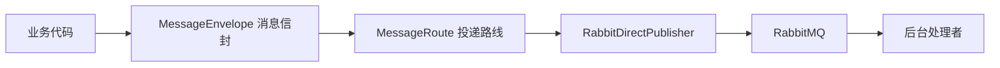

# 第 26 课：RabbitMQ 与异步任务（小白版）

## 这节课要解决什么问题

前面我们学了 Agent 如何聊天、查知识库、调用工具、记住用户。

但一个真实平台不可能所有事情都“当场做完”。

比如：

- 用户上传一个很大的 PDF
- 系统要解析文件、切分文本、生成向量
- 定时任务到点后要自动执行
- 执行 trace、模型状态变化、订单成功后要通知别的模块

这些事情有一个共同特点：

```text
用户不一定要站在原地等它全部完成。
```

这就是异步任务要解决的问题。

## 一句话理解异步任务

同步任务像你在窗口排队买奶茶：

```text
你下单
店员马上做
你一直等
做好后你才能离开
```

异步任务像你拿了一个取餐号：

```text
你下单
系统给你一个号码
后台慢慢做
做好后通知你
```

RabbitMQ 就像中间的“取餐叫号系统”。

## RabbitMQ 是什么

RabbitMQ 是一个消息队列。

你可以先把它想象成一个邮箱：

```text
发送方：把任务纸条放进邮箱
RabbitMQ：负责保管和排队
接收方：从邮箱取出纸条，然后干活
```

在程序里，这张“纸条”通常叫消息。

## AgentX 里为什么需要消息队列

AgentX 有很多比较耗时、或者不适合挤在一次请求里的事情。

例如 RAG 文件处理：

```text
用户上传文件
  -> 后端保存文件信息
  -> 发送“请处理这个文件”的消息
  -> 后台消费者慢慢处理
  -> 更新文件状态
```

这样用户界面不会一直卡住。

## 先认识几个关键词

### 1. Producer：生产者

生产者就是“发消息的人”。

比如某段代码发现：

```text
有一个文档需要同步到存储
```

它就向 RabbitMQ 发一条消息。

### 2. Queue：队列

队列就是“排队的地方”。

先来的消息排前面，后来的消息排后面。

### 3. Consumer：消费者

消费者就是“拿消息干活的人”。

它从队列里取出消息，然后执行真正的业务逻辑。

### 4. Exchange：交换机

交换机像一个前台分拣员。

它根据规则把消息送到对应的队列。

## AgentX 源码阅读路线

建议按这个顺序看：

```text
E:\agentx\AgentX\AgentX\src\main\java\org\xhy\infrastructure\mq\core\MessageEnvelope.java
E:\agentx\AgentX\AgentX\src\main\java\org\xhy\infrastructure\mq\core\MessageRoute.java
E:\agentx\AgentX\AgentX\src\main\java\org\xhy\infrastructure\mq\core\MessagePublisher.java
E:\agentx\AgentX\AgentX\src\main\java\org\xhy\infrastructure\mq\rabbit\RabbitDirectConfig.java
E:\agentx\AgentX\AgentX\src\main\java\org\xhy\infrastructure\mq\rabbit\RabbitDirectPublisher.java
E:\agentx\AgentX\AgentX\src\main\java\org\xhy\infrastructure\mq\events\RagDocSyncStorageEvent.java
E:\agentx\AgentX\AgentX\src\main\java\org\xhy\infrastructure\mq\events\RagDocSyncOcrEvent.java
```

你不用一上来理解每一行。

先抓住这句话：

```text
core 定义“消息长什么样”，rabbit 负责“怎么发出去”，events 定义“业务消息是什么”。
```

## AgentX 的消息结构

可以把一条消息理解成快递包裹。

```text
快递盒子：MessageEnvelope
快递地址：MessageRoute
快递内容：具体事件对象
快递公司：RabbitMQ
```

简化理解如下：



## RabbitDirectConfig 做什么

文件：

```text
E:\agentx\AgentX\AgentX\src\main\java\org\xhy\infrastructure\mq\rabbit\RabbitDirectConfig.java
```

它主要做两件事：

```text
1. 根据配置创建 RabbitMQ 连接
2. 把 MessagePublisher 注册成 Spring Bean
```

你可以把它理解成：

```text
先把电话线接好，再把“打电话的人”交给系统使用。
```

其中连接信息来自 Spring 的 RabbitProperties，也就是项目配置里的 RabbitMQ 地址、端口、用户名、密码。

## RabbitDirectPublisher 做什么

文件：

```text
E:\agentx\AgentX\AgentX\src\main\java\org\xhy\infrastructure\mq\rabbit\RabbitDirectPublisher.java
```

它负责真正把消息发到 RabbitMQ。

核心步骤可以读成：

```text
1. 创建 channel
2. 声明 exchange
3. 声明 queue
4. 绑定 queue 和 exchange
5. 把消息转成 JSON
6. basicPublish 发出去
```

它里面的 `deliveryMode(2)` 可以简单理解为：

```text
这条消息比较重要，尽量持久化保存。
```

## EventListener 也是异步思想的一部分

AgentX 不只用 RabbitMQ，也用了 Spring 自带的事件机制。

比如执行追踪：

```text
E:\agentx\AgentX\AgentX\src\main\java\org\xhy\application\trace\listener\TraceEventListener.java
```

当对话过程中发生：

- 执行开始
- 模型调用完成
- 工具执行完成
- 执行结束

系统会发布事件，监听器负责记录 trace。

你可以这样理解：

```text
主流程只负责把饭做好。
监听器负责记账、写日志、更新统计。
```

## 定时任务也是后台任务

相关文件：

```text
E:\agentx\AgentX\AgentX\src\main\java\org\xhy\domain\scheduledtask\service\DelayedTaskQueueManager.java
E:\agentx\AgentX\AgentX\src\main\java\org\xhy\domain\scheduledtask\service\TaskScheduleService.java
E:\agentx\AgentX\AgentX\src\main\java\org\xhy\domain\scheduledtask\service\ScheduleTaskExecutor.java
E:\agentx\AgentX\AgentX\src\main\java\org\xhy\interfaces\api\portal\scheduledtask\PortalScheduledTaskController.java
```

定时任务像闹钟。

```text
用户设置：明天上午 9 点执行某个 Agent
系统保存任务
时间到了
后台执行
保存结果
```

## 异步任务的好处

### 1. 用户体验更好

用户不用一直等。

### 2. 系统更稳定

慢任务不会堵住主要请求。

### 3. 模块更解耦

上传文件的人不需要知道具体怎么解析 PDF、怎么 OCR、怎么生成向量。

### 4. 失败更容易重试

任务失败后，可以重新投递或重新执行。

## 你读源码时要抓住的问题

看异步任务，不要先纠结 RabbitMQ 的所有配置。

先问四个问题：

```text
谁发消息？
消息长什么样？
发到哪里？
谁处理消息？
```

这四个问题搞清楚，一条异步链路就基本读懂了。

## 本课小结

这一课你只要记住：

```text
异步任务 = 把不需要立刻完成的事情，先放进队列，后台慢慢做。
```

在 AgentX 中：

- RabbitMQ 负责消息投递
- `MessageEnvelope` 表示消息包装
- `MessageRoute` 表示投递路线
- `RabbitDirectPublisher` 负责发送消息
- Spring EventListener 负责处理系统内部事件
- 定时任务属于另一类后台执行能力

## 小练习

### 练习 1

如果用户上传了一个很大的 PDF，为什么不建议在上传接口里直接完成所有解析和向量化？

参考答案：

```text
因为文件解析和向量化可能很慢。如果全部放在上传接口里，用户页面会一直等待，接口也更容易超时。更好的方式是先保存文件，再把处理任务交给后台异步执行。
```

### 练习 2

`RabbitDirectPublisher` 在 AgentX 中大概承担什么角色？

参考答案：

```text
它承担“消息发送员”的角色，把业务消息按照指定路线发送到 RabbitMQ。
```

### 练习 3

读异步代码时，最应该先问哪四个问题？

参考答案：

```text
谁发消息、消息长什么样、发到哪里、谁处理消息。
```

