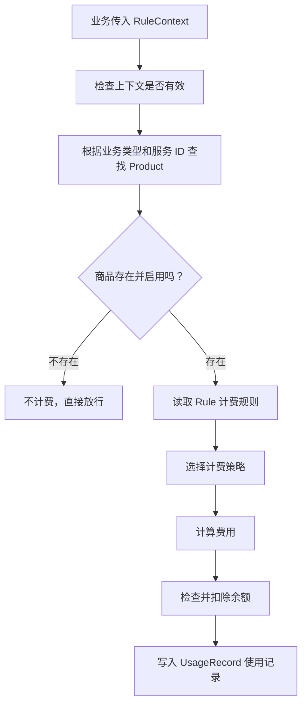
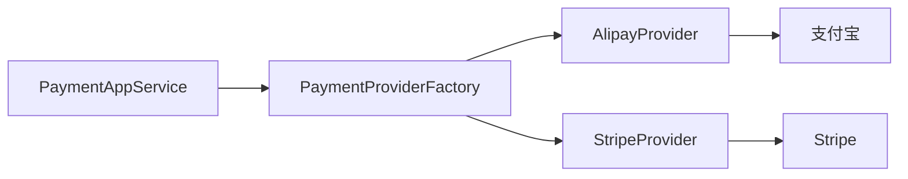

# 第 27 课：计费系统（小白版）

## 这节课要解决什么问题

AgentX 不只是一个聊天工具，它更像一个可以商业化运营的 Agent 平台。

既然是平台，就会遇到这些问题：

- 用户账户里有多少钱？
- 调用一次模型要不要扣费？
- 不同模型价格一样吗？
- 充值订单怎么创建？
- 支付成功后余额怎么增加？
- 每次消费要不要留下记录？

这些问题加起来，就是计费系统。

## 一句话理解计费系统

计费系统像奶茶店的收银台。

```text
菜单 = 产品
价格规则 = 计费规则
钱包 = 用户账户
小票 = 使用记录
支付平台 = 支付宝、Stripe 等
```

AgentX 的计费系统就是负责：

```text
知道你用了什么服务，算出多少钱，从余额里扣掉，并留下记录。
```

## 先认识核心概念

### 1. Account：账户余额

账户余额就是用户钱包。

源码位置：

```text
E:\agentx\AgentX\AgentX\src\main\java\org\xhy\domain\user\model\AccountEntity.java
E:\agentx\AgentX\AgentX\src\main\java\org\xhy\domain\user\service\AccountDomainService.java
E:\agentx\AgentX\AgentX\src\main\java\org\xhy\application\account\service\AccountAppService.java
E:\agentx\AgentX\AgentX\src\main\java\org\xhy\interfaces\api\portal\account\AccountController.java
```

你可以把它理解为：

```text
用户的钱放在哪里、怎么充值、怎么扣费。
```

### 2. Product：商品

商品不是实体物品，而是“可计费服务”。

比如：

```text
某个模型调用服务
某个工具执行服务
某种高级能力
```

源码可以从这里找：

```text
E:\agentx\AgentX\AgentX\src\main\java\org\xhy\domain\product
E:\agentx\AgentX\AgentX\src\main\java\org\xhy\application\product
E:\agentx\AgentX\AgentX\src\main\java\org\xhy\interfaces\api\admin\AdminProductController.java
```

### 3. Rule：计费规则

规则告诉系统：

```text
这个商品应该怎么算钱。
```

比如：

```text
按 token 数计费
按调用次数计费
按固定单价计费
```

相关策略：

```text
E:\agentx\AgentX\AgentX\src\main\java\org\xhy\infrastructure\billing\strategy\BillingStrategyFactory.java
E:\agentx\AgentX\AgentX\src\main\java\org\xhy\infrastructure\billing\strategy\ModelTokenStrategy.java
E:\agentx\AgentX\AgentX\src\main\java\org\xhy\infrastructure\billing\strategy\PerUnitStrategy.java
```

### 4. UsageRecord：使用记录

使用记录就是消费小票。

源码位置：

```text
E:\agentx\AgentX\AgentX\src\main\java\org\xhy\domain\user\model\UsageRecordEntity.java
E:\agentx\AgentX\AgentX\src\main\java\org\xhy\domain\user\service\UsageRecordDomainService.java
E:\agentx\AgentX\AgentX\src\main\java\org\xhy\application\usage\service\UsageRecordAppService.java
E:\agentx\AgentX\AgentX\src\main\java\org\xhy\interfaces\api\portal\usage\PortalUsageRecordController.java
```

它回答的问题是：

```text
谁在什么时候用了什么服务，花了多少钱。
```

## 计费主流程

重点文件：

```text
E:\agentx\AgentX\AgentX\src\main\java\org\xhy\application\billing\service\BillingService.java
```

你可以把 `BillingService.charge()` 当作计费系统的主入口。

简化流程如下：



## RuleContext 是什么

文件：

```text
E:\agentx\AgentX\AgentX\src\main\java\org\xhy\application\billing\dto\RuleContext.java
```

它像一张结账单，上面写着：

```text
谁要付钱
用了什么服务
用了多少
这次请求的唯一编号是什么
```

为什么需要请求编号？

为了防止重复扣费。

比如网络抖动导致同一个请求被提交了两次，系统可以通过 `requestId` 判断：

```text
这笔账已经算过了，不要重复扣。
```

## 计费策略是什么

计费策略就是不同的算钱方法。

AgentX 用了策略模式。

你可以先这样理解：

```text
不同商品交给不同计算器。
```

例如：

- `ModelTokenStrategy`：按模型 token 计算
- `PerUnitStrategy`：按次数或单位计算
- `BillingStrategyFactory`：根据规则选择具体策略

类比一下：

```text
买奶茶按杯算
打车按里程算
打印按页数算
模型调用按 token 算
```

## 为什么费用小于 0.01 元时要处理

在 `BillingService` 中可以看到：

```text
如果费用大于 0 但小于 0.01，就按 0.01 计算。
```

这叫最低计费。

现实里很多平台也会这样做，因为金额太小可能不方便入账、展示和统计。

## 充值和支付链路

充值不是直接把余额加上去。

它通常要经过：

```text
创建订单
调用支付平台
用户付款
支付平台回调
订单变成已支付
余额增加
```

相关源码：

```text
E:\agentx\AgentX\AgentX\src\main\java\org\xhy\application\payment\service\PaymentAppService.java
E:\agentx\AgentX\AgentX\src\main\java\org\xhy\domain\order\model\OrderEntity.java
E:\agentx\AgentX\AgentX\src\main\java\org\xhy\domain\order\service\OrderDomainService.java
E:\agentx\AgentX\AgentX\src\main\java\org\xhy\infrastructure\payment\provider\PaymentProvider.java
E:\agentx\AgentX\AgentX\src\main\java\org\xhy\infrastructure\payment\provider\AlipayProvider.java
E:\agentx\AgentX\AgentX\src\main\java\org\xhy\infrastructure\payment\provider\StripeProvider.java
E:\agentx\AgentX\AgentX\src\main\java\org\xhy\application\account\listener\RechargeEventListener.java
```

## 支付平台为什么要抽象成 Provider

因为不同支付平台的接口不一样。

支付宝有支付宝的方式，Stripe 有 Stripe 的方式。

但 AgentX 内部希望统一说：

```text
帮我创建一笔支付。
帮我查询支付状态。
帮我处理支付回调。
```

这就是 `PaymentProvider` 的意义。



## 前端在哪里看账单

前端相关文件：

```text
E:\agentx\AgentX\agentx-frontend-plus\app\(main)\settings\billing\page.tsx
E:\agentx\AgentX\agentx-frontend-plus\app\(main)\settings\orders\page.tsx
E:\agentx\AgentX\agentx-frontend-plus\lib\account-service.ts
E:\agentx\AgentX\agentx-frontend-plus\lib\payment-service.ts
E:\agentx\AgentX\agentx-frontend-plus\lib\order-service.ts
E:\agentx\AgentX\agentx-frontend-plus\lib\usage-record-service.ts
```

你可以这样读：

```text
页面负责展示和按钮
service 文件负责调用后端 API
后端 Controller 接收请求
AppService 编排业务
DomainService 修改数据
```

## 读计费系统时的主线

不要一开始就陷入支付细节。

先抓住两条线：

```text
消费线：用服务 -> 算钱 -> 扣余额 -> 写使用记录
充值线：建订单 -> 去支付 -> 回调成功 -> 加余额
```

## 本课小结

本课你要记住：

- Account 是用户钱包
- Product 是可计费服务
- Rule 是计算价格的规则
- BillingStrategy 是具体计算器
- UsageRecord 是消费小票
- Order 是充值订单
- PaymentProvider 是支付平台适配器

计费系统本质上是在回答：

```text
谁用了什么，应该付多少，钱从哪里扣，记录保存在哪里。
```

## 小练习

### 练习 1

为什么计费系统要记录 `UsageRecord`？

参考答案：

```text
因为用户和平台都需要知道每次消费发生在什么时候、用了什么服务、花了多少钱。它也方便后续查账、统计和排查问题。
```

### 练习 2

`BillingStrategyFactory` 的作用是什么？

参考答案：

```text
它像一个计算器选择器，根据计费规则找到对应的计费策略，比如按 token 算或按次数算。
```

### 练习 3

充值成功后为什么通常不是支付接口直接加余额，而是通过订单和回调处理？

参考答案：

```text
因为支付结果要以支付平台确认为准。订单能记录支付过程，回调能告诉系统用户是否真的付款成功，然后再安全地增加余额。
```

