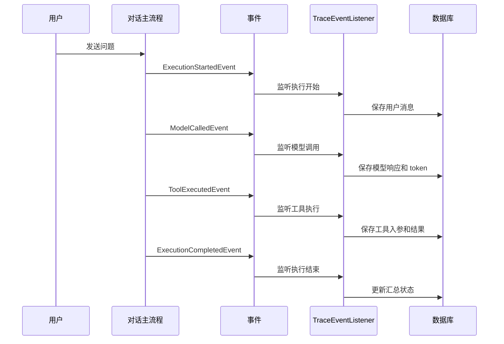

# 第 28 课：执行追踪与监控（小白版）

## 这节课要解决什么问题

当用户问 Agent 一个问题时，背后可能发生很多事情：

```text
读取历史消息
加载 Agent 配置
检索知识库
调用工具
调用模型
模型失败后切换备用模型
返回答案
记录 token 和费用
```

如果结果出错，只看最终回答是不够的。

我们还需要知道：

- 哪一步开始执行？
- 模型调用用了多少 token？
- 工具调用有没有失败？
- RAG 有没有检索到内容？
- 总耗时是多少？
- 失败发生在哪个阶段？

这就是执行追踪。

## 一句话理解执行追踪

执行追踪像外卖订单详情。

你不只看到：

```text
外卖到了
```

你还能看到：

```text
商家已接单
骑手已取餐
正在配送
已送达
```

AgentX 的 trace 就是在记录一次 Agent 执行过程中的关键步骤。

## TraceId 是什么

TraceId 可以理解为一次执行的订单号。

一次用户提问，会产生一个 traceId。

后面的模型调用、工具调用、错误信息，都可以挂在这个 traceId 下面。

```text
traceId = 把一整次执行串起来的编号
```

## AgentX 的追踪源码在哪里

先看这一组：

```text
E:\agentx\AgentX\AgentX\src\main\java\org\xhy\application\trace\collector\TraceCollector.java
E:\agentx\AgentX\AgentX\src\main\java\org\xhy\application\trace\listener\TraceEventListener.java
E:\agentx\AgentX\AgentX\src\main\java\org\xhy\application\trace\service\AgentExecutionTraceAppService.java
E:\agentx\AgentX\AgentX\src\main\java\org\xhy\domain\trace\service\AgentExecutionTraceDomainService.java
```

再看数据模型：

```text
E:\agentx\AgentX\AgentX\src\main\java\org\xhy\domain\trace\model\TraceContext.java
E:\agentx\AgentX\AgentX\src\main\java\org\xhy\domain\trace\model\AgentExecutionSummaryEntity.java
E:\agentx\AgentX\AgentX\src\main\java\org\xhy\domain\trace\model\AgentExecutionDetailEntity.java
E:\agentx\AgentX\AgentX\src\main\java\org\xhy\domain\trace\model\ModelCallInfo.java
E:\agentx\AgentX\AgentX\src\main\java\org\xhy\domain\trace\model\ToolCallInfo.java
```

最后看 API：

```text
E:\agentx\AgentX\AgentX\src\main\java\org\xhy\interfaces\api\portal\agent\PortalTraceController.java
```

## Summary 和 Detail 的区别

这两个词很重要。

### Summary：汇总记录

Summary 像订单列表里的一行：

```text
这次执行成功了吗？
总共用了多久？
总 token 数是多少？
工具调用了几次？
花了多少钱？
```

对应：

```text
AgentExecutionSummaryEntity
```

### Detail：详细步骤

Detail 像订单详情里的每一步：

```text
第 1 步：用户消息
第 2 步：模型调用
第 3 步：工具调用
第 4 步：AI 响应
```

对应：

```text
AgentExecutionDetailEntity
```

## TraceContext 是什么

文件：

```text
E:\agentx\AgentX\AgentX\src\main\java\org\xhy\domain\trace\model\TraceContext.java
```

它像一张执行身份证。

里面通常会带着：

```text
traceId
userId
agentId
sessionId
messageId
```

只要后续步骤拿着这张身份证，就知道自己属于哪一次执行。

## TraceEventListener 做什么

文件：

```text
E:\agentx\AgentX\AgentX\src\main\java\org\xhy\application\trace\listener\TraceEventListener.java
```

它监听几类事件：

- `ExecutionStartedEvent`
- `ModelCalledEvent`
- `ToolExecutedEvent`
- `ExecutionCompletedEvent`

你可以这样理解：

```text
主流程每完成一个重要动作，就喊一声。
TraceEventListener 听到以后，把这一步记录下来。
```

简化图：



## 前端追踪页面在哪里

前端页面：

```text
E:\agentx\AgentX\agentx-frontend-plus\app\(main)\traces\page.tsx
E:\agentx\AgentX\agentx-frontend-plus\app\(main)\traces\agents\[agentId]
```

前端服务：

```text
E:\agentx\AgentX\agentx-frontend-plus\lib\agent-trace-service.ts
```

后端接口：

```text
E:\agentx\AgentX\AgentX\src\main\java\org\xhy\interfaces\api\portal\agent\PortalTraceController.java
```

你可以对应着看：

```text
前端 getUserAgentTraceStatistics()
  -> GET /traces/agents
  -> PortalTraceController.getUserAgentTraceStatistics()
  -> AgentExecutionTraceAppService
  -> AgentExecutionTraceDomainService
```

## 追踪能帮我们排查什么问题

### 1. 模型没有返回

看模型调用记录：

```text
是否成功？
用了哪个 provider？
是否触发 fallback？
错误信息是什么？
```

### 2. 工具调用失败

看工具记录：

```text
工具名是什么？
请求参数是什么？
返回内容是什么？
执行耗时是多少？
```

### 3. 成本太高

看 token 和 cost：

```text
输入 token 多还是输出 token 多？
是否历史消息太长？
是否 RAG 注入内容太多？
```

### 4. 响应太慢

看每一步耗时：

```text
是模型慢？
是工具慢？
是检索慢？
还是整体排队慢？
```

## ExecutionPhase 是什么

文件：

```text
E:\agentx\AgentX\AgentX\src\main\java\org\xhy\domain\trace\constant\ExecutionPhase.java
```

它用于描述错误发生的阶段。

比如：

```text
加载 Agent 阶段
调用模型阶段
调用工具阶段
完成阶段
```

这样失败时就不是一句“系统错误”，而是更明确地知道：

```text
到底哪里坏了。
```

## 执行追踪和日志有什么区别

日志更偏程序员调试：

```text
某个类打印了什么信息。
```

执行追踪更偏业务视角：

```text
一次 Agent 执行经历了哪些步骤。
```

可以这样记：

```text
日志看代码运行，trace 看业务过程。
```

## 本课小结

本课你要记住：

- traceId 是一次执行的编号
- Summary 是一次执行的汇总
- Detail 是执行过程中的每一步
- TraceContext 像执行身份证
- TraceEventListener 负责监听事件并记录过程
- PortalTraceController 提供前端查询接口
- 前端 `agent-trace-service.ts` 负责调用这些接口

执行追踪的价值是：

```text
当 Agent 出问题时，我们能从“结果不好”追到“哪一步出了问题”。
```

## 小练习

### 练习 1

为什么只看最终回答，不足以排查 Agent 问题？

参考答案：

```text
因为最终回答只能说明结果，不能说明过程。Agent 可能在模型调用、工具调用、RAG 检索、记忆注入等多个步骤中出问题，需要 trace 才能定位具体阶段。
```

### 练习 2

Summary 和 Detail 分别适合看什么？

参考答案：

```text
Summary 适合看一次执行的整体情况，比如是否成功、总耗时、总 token、总费用。Detail 适合看执行中的每一步，比如模型调用、工具调用、错误信息。
```

### 练习 3

如果你想知道某次工具调用的入参和返回结果，应该优先看哪个实体？

参考答案：

```text
优先看 AgentExecutionDetailEntity，因为工具调用属于执行过程中的详细步骤。
```

