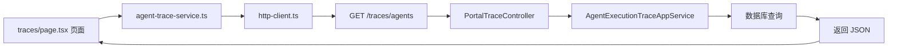

# 第 29 课：前端架构学习（小白版）

## 这节课要解决什么问题

前面 28 节课大多在读后端。

但用户真正看到的是前端页面。

比如：

- 登录页面
- Agent 广场
- 聊天页面
- 创建 Agent 页面
- 知识库页面
- 工具市场
- 后台管理系统
- 账单和订单页面

这一课我们开始理解：

```text
AgentX 的前端页面是怎么组织的，页面又是怎么调用后端 API 的。
```

## 一句话理解前端

前端像餐厅的大厅和菜单。

后端像厨房。

```text
用户在前端点菜
前端把请求传给后端
后端处理后把结果返回
前端再展示给用户
```

## 前端项目在哪里

AgentX 的前端目录是：

```text
E:\agentx\AgentX\agentx-frontend-plus
```

重要文件和文件夹：

```text
E:\agentx\AgentX\agentx-frontend-plus\package.json
E:\agentx\AgentX\agentx-frontend-plus\app
E:\agentx\AgentX\agentx-frontend-plus\components
E:\agentx\AgentX\agentx-frontend-plus\hooks
E:\agentx\AgentX\agentx-frontend-plus\lib
E:\agentx\AgentX\agentx-frontend-plus\types
```

## package.json 是什么

文件：

```text
E:\agentx\AgentX\agentx-frontend-plus\package.json
```

它像前端项目的说明书。

里面会写：

```text
这个项目叫什么
怎么启动
用了哪些依赖
```

你会看到：

```json
"dev": "next dev",
"build": "next build",
"start": "next start"
```

含义是：

```text
npm run dev：开发时启动
npm run build：打包
npm run start：运行打包后的版本
```

## Next.js App Router 是什么

AgentX 前端使用 Next.js。

你可以先把 Next.js 理解成：

```text
一个帮我们组织 React 页面和路由的框架。
```

在 App Router 中，`app` 文件夹的目录结构就会变成页面地址。

例如：

```text
app\(main)\explore\page.tsx
```

大致对应：

```text
/explore
```

```text
app\(main)\settings\billing\page.tsx
```

大致对应：

```text
/settings/billing
```

## app 文件夹怎么读

重点目录：

```text
E:\agentx\AgentX\agentx-frontend-plus\app
```

你会看到：

```text
(auth)
(main)
widget
```

### (auth)

认证相关页面。

比如登录、注册等。

### (main)

登录后的主应用。

常见页面都在这里：

```text
E:\agentx\AgentX\agentx-frontend-plus\app\(main)\explore
E:\agentx\AgentX\agentx-frontend-plus\app\(main)\studio
E:\agentx\AgentX\agentx-frontend-plus\app\(main)\knowledge
E:\agentx\AgentX\agentx-frontend-plus\app\(main)\tools
E:\agentx\AgentX\agentx-frontend-plus\app\(main)\traces
E:\agentx\AgentX\agentx-frontend-plus\app\(main)\settings
E:\agentx\AgentX\agentx-frontend-plus\app\(main)\admin
```

### widget

外部嵌入聊天相关页面。

也就是前面学过的 Widget 能力。

## page.tsx 是什么

`page.tsx` 可以先理解为：

```text
这个地址真正显示的页面。
```

例如：

```text
E:\agentx\AgentX\agentx-frontend-plus\app\(main)\traces\page.tsx
```

就是执行追踪页面。

```text
E:\agentx\AgentX\agentx-frontend-plus\app\(main)\admin\orders\page.tsx
```

就是后台订单管理页面。

## layout.tsx 是什么

`layout.tsx` 可以理解为页面外壳。

比如：

```text
导航栏
侧边栏
统一布局
权限包裹
```

如果 `page.tsx` 是具体房间，`layout.tsx` 就是楼层结构和走廊。

## lib 目录是什么

重点目录：

```text
E:\agentx\AgentX\agentx-frontend-plus\lib
```

这里有大量 `*-service.ts` 文件。

它们不是页面，而是前端调用后端 API 的工具。

比如：

```text
agent-service.ts：Agent 相关接口
rag-dataset-service.ts：知识库相关接口
tool-service.ts：工具相关接口
agent-trace-service.ts：执行追踪相关接口
payment-service.ts：支付相关接口
usage-record-service.ts：使用记录相关接口
```

你可以这样理解：

```text
页面负责“长什么样”
service 负责“去后端拿数据”
```

## http-client.ts 是什么

文件：

```text
E:\agentx\AgentX\agentx-frontend-plus\lib\http-client.ts
```

它是前端统一请求后端的入口。

作用包括：

- 拼接 API 地址
- 设置请求头
- 处理 JSON
- 处理超时
- 遇到 401 跳转登录
- 标准化错误信息

如果把后端 API 比作厨房窗口，`http-client.ts` 就是所有服务员统一走的通道。

## 一个前端请求的完整路线

以执行追踪页面为例：

前端服务：

```text
E:\agentx\AgentX\agentx-frontend-plus\lib\agent-trace-service.ts
```

后端接口：

```text
E:\agentx\AgentX\AgentX\src\main\java\org\xhy\interfaces\api\portal\agent\PortalTraceController.java
```

流程图：



## components 目录是什么

目录：

```text
E:\agentx\AgentX\agentx-frontend-plus\components
```

组件就是可以复用的小积木。

比如：

- 按钮
- 弹窗
- 表格
- 输入框
- 卡片
- 聊天消息块

页面通常不是一整块写到底，而是由很多组件拼起来。

## hooks 目录是什么

目录：

```text
E:\agentx\AgentX\agentx-frontend-plus\hooks
```

Hook 可以理解为页面逻辑的小工具。

比如：

```text
保存某个状态
封装某个交互
复用某段加载数据的逻辑
```

对于小白来说，先不用急着深入 React Hook 原理。

先记住：

```text
hooks 通常放可复用的页面逻辑。
```

## 后台管理页面在哪里

后台管理系统相关页面：

```text
E:\agentx\AgentX\agentx-frontend-plus\app\(main)\admin
```

常见模块：

```text
admin\agents：Agent 审核或管理
admin\orders：订单管理
admin\products：产品管理
admin\rules：计费规则管理
admin\tools：工具管理
admin\rags：知识库管理
admin\providers：模型服务商管理
admin\containers：容器管理
```

对应后端通常在：

```text
E:\agentx\AgentX\AgentX\src\main\java\org\xhy\interfaces\api\admin
```

## 学前端源码的建议路线

不要从一堆组件开始乱翻。

建议路线：

```text
1. 先找页面：app 目录里的 page.tsx
2. 再找页面调用的 service：lib 目录里的 *-service.ts
3. 再找后端 Controller：interfaces/api
4. 最后回到页面看数据怎么展示
```

比如你想看账单：

```text
settings\billing\page.tsx
  -> payment-service.ts / usage-record-service.ts
  -> AccountController / PaymentController / PortalUsageRecordController
```

## 本课小结

本课你要记住：

- 前端项目在 `agentx-frontend-plus`
- `app` 决定页面和路由
- `page.tsx` 是具体页面
- `layout.tsx` 是页面外壳
- `lib/*-service.ts` 负责调用后端接口
- `http-client.ts` 是统一请求工具
- `components` 是可复用 UI 积木
- `hooks` 是可复用前端逻辑

读前端时，最稳的路线是：

```text
页面 -> service -> http-client -> 后端 Controller
```

## 小练习

### 练习 1

如果你想找到订单管理页面，应该优先看哪个文件？

参考答案：

```text
E:\agentx\AgentX\agentx-frontend-plus\app\(main)\admin\orders\page.tsx
```

### 练习 2

`lib\http-client.ts` 的作用是什么？

参考答案：

```text
它是前端统一请求后端的工具，负责拼接地址、设置请求头、处理响应、处理错误和登录过期等情况。
```

### 练习 3

为什么不建议一开始就从 components 目录读起？

参考答案：

```text
因为 components 是零散积木，不知道页面业务时容易迷路。先从 page.tsx 找到具体页面，再顺着 service 和后端接口读，更容易建立完整链路。
```

