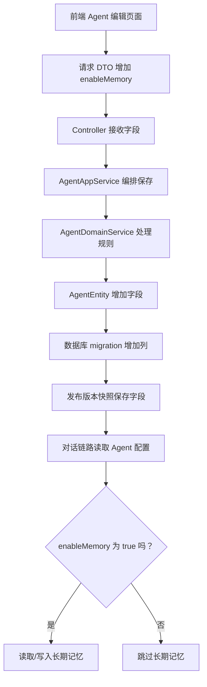

# 第 30 课：综合实战：新增一个 Agent 能力（小白版）

## 这节课要解决什么问题

这是最后一课。

前面 29 节课，我们分别学了：

- 项目怎么启动
- 后端怎么分层
- Agent 怎么创建和发布
- 一次对话怎么执行
- 工具、MCP、RAG、记忆怎么增强 Agent
- 异步任务、计费、追踪、前端页面怎么支撑平台

现在要把这些知识串起来。

这一课不要求你立刻写复杂功能。

目标是让你知道：

```text
如果我要给 AgentX 新增一个能力，应该从哪里开始，沿着哪些文件改，怎么验证。
```

## 新增能力不是只改一个文件

小白最容易有一个误解：

```text
我想加一个功能，是不是找到一个文件改一下就行？
```

真实项目通常不是这样。

一个功能往往会穿过很多层：

```text
前端页面
  -> API 请求
  -> Controller
  -> AppService
  -> DomainService
  -> Entity
  -> Repository
  -> 数据库
  -> 对话链路
  -> 追踪和计费
```

所以最后一课，我们学“改功能的路线图”。

## 本课选择的实战题

我们选择一个适合入门的实战：

```text
给长期记忆增加一个 Agent 级别开关。
```

意思是：

```text
有些 Agent 允许使用长期记忆
有些 Agent 不使用长期记忆
```

为什么选这个？

因为它能串起很多知识点：

- Agent 配置字段
- 前端表单
- 后端 DTO
- 应用层保存
- 对话时读取配置
- 记忆模块是否启用
- 测试和验证

## 先用人话描述需求

不要一上来写代码。

先把需求说清楚：

```text
作为 Agent 创建者，
我希望在编辑 Agent 时可以打开或关闭长期记忆，
这样我可以控制这个 Agent 是否记住用户偏好。
```

再补充规则：

```text
默认关闭还是默认开启？
关闭后是否还读取旧记忆？
关闭后是否还抽取新记忆？
普通用户能不能修改？
发布版本是否要保存这个开关？
```

这一步很重要。

很多 bug 不是代码不会写，而是需求没说清楚。

## 推荐规则设计

为了简单，我们先设计成：

```text
1. Agent 新增字段 enableMemory
2. 默认关闭
3. 打开后，对话时可以检索和写入长期记忆
4. 关闭后，不读取记忆，也不写入新记忆
5. 发布版本时，这个配置进入版本快照
```

## 改动路线总图



## 第一步：找到 Agent 数据模型

先看：

```text
E:\agentx\AgentX\AgentX\src\main\java\org\xhy\domain\agent\model\AgentEntity.java
E:\agentx\AgentX\AgentX\src\main\java\org\xhy\domain\agent\model\AgentVersionEntity.java
```

你要判断：

```text
Agent 当前有哪些配置字段？
发布版本保存哪些字段？
```

如果是新增开关，通常需要：

```text
AgentEntity 增加 enableMemory
AgentVersionEntity 或版本配置结构也保存 enableMemory
```

## 第二步：找到创建和编辑 Agent 的接口

后端入口：

```text
E:\agentx\AgentX\AgentX\src\main\java\org\xhy\interfaces\api\portal\agent\PortalAgentController.java
```

应用层：

```text
E:\agentx\AgentX\AgentX\src\main\java\org\xhy\application\agent\service\AgentAppService.java
```

领域层：

```text
E:\agentx\AgentX\AgentX\src\main\java\org\xhy\domain\agent\service\AgentDomainService.java
```

请求 DTO 通常在：

```text
E:\agentx\AgentX\AgentX\src\main\java\org\xhy\interfaces\dto\agent
```

你要找：

```text
创建 Agent 的 request
更新 Agent 的 request
返回 Agent 的 response 或 DTO
```

然后把 `enableMemory` 加进去。

## 第三步：数据库要保存字段

如果只是 Java 类增加字段，数据库没有这一列，程序保存时可能会出错。

所以还要看数据库迁移目录：

```text
E:\agentx\AgentX\AgentX\src\main\resources\db\migration
```

你需要新增一个 migration 文件，类似：

```sql
ALTER TABLE agents ADD COLUMN enable_memory BOOLEAN DEFAULT FALSE;
```

注意：实际表名和字段命名要以项目现有 migration 为准。

小白阶段先记住：

```text
Entity 改字段，数据库通常也要跟着改。
```

## 第四步：前端表单增加开关

前端创建和编辑 Agent 的页面大概在：

```text
E:\agentx\AgentX\agentx-frontend-plus\app\(main)\studio\new\page.tsx
E:\agentx\AgentX\agentx-frontend-plus\app\(main)\studio\edit\[id]
E:\agentx\AgentX\agentx-frontend-plus\lib\agent-service.ts
```

你要做的事情是：

```text
页面上增加一个开关
表单状态里增加 enableMemory
提交时传给后端
从后端加载 Agent 时回显这个值
```

前端开关可以理解成：

```text
用户点一下，数据从 false 变 true。
再点一下，从 true 变 false。
```

## 第五步：对话链路中使用这个开关

长期记忆相关源码：

```text
E:\agentx\AgentX\AgentX\src\main\java\org\xhy\domain\memory\service\MemoryExtractorService.java
E:\agentx\AgentX\AgentX\src\main\java\org\xhy\domain\memory\service\MemoryDomainService.java
E:\agentx\AgentX\AgentX\src\main\java\org\xhy\application\conversation\service\message\AbstractMessageHandler.java
```

对话主链路：

```text
E:\agentx\AgentX\AgentX\src\main\java\org\xhy\application\conversation\service\ConversationAppService.java
E:\agentx\AgentX\AgentX\src\main\java\org\xhy\application\conversation\service\message\agent\AgentMessageHandler.java
```

你要找：

```text
哪里读取长期记忆？
哪里抽取并保存长期记忆？
哪里有 Agent 配置？
```

然后加判断：

```text
if enableMemory:
    使用长期记忆
else:
    跳过长期记忆
```

## 第六步：发布版本也要考虑

前面我们学过 Agent 版本管理。

如果 Agent 发布后使用的是版本快照，而不是草稿本身，那么你必须确认：

```text
enableMemory 是否进入版本快照？
对话时读取的是草稿配置还是版本配置？
```

相关文件：

```text
E:\agentx\AgentX\AgentX\src\main\java\org\xhy\domain\agent\model\AgentVersionEntity.java
E:\agentx\AgentX\AgentX\src\main\java\org\xhy\application\agent\service\AgentAppService.java
```

这一步非常重要。

否则会出现：

```text
编辑页面明明打开了开关，但发布后对话不生效。
```

## 第七步：追踪和计费是否要改

这次功能不一定需要改计费。

但可以考虑 trace。

比如你想在执行追踪里看到：

```text
本次是否启用了长期记忆
检索到了几条记忆
```

那就会涉及：

```text
TraceCollector
TraceEventListener
AgentExecutionDetailEntity
前端 trace 展示
```

初学者第一版可以不做。

先把核心功能跑通。

## 第八步：验证清单

每次改功能，都要有验证清单。

这次可以这样测：

```text
1. 创建一个 Agent，默认 enableMemory 为 false
2. 编辑 Agent，把长期记忆打开
3. 保存后刷新页面，开关仍然是打开
4. 发布 Agent
5. 和 Agent 对话，确认会使用长期记忆
6. 关闭开关，再对话，确认不会读取和写入记忆
7. 检查数据库字段是否保存正确
8. 检查接口返回值是否包含 enableMemory
```

## 如果你要换一个实战题

也可以选择这些：

### 方案 A：给 RAG 检索结果展示 score

适合练习：

```text
RAG 检索
DTO 返回
前端展示
```

### 方案 B：新增一个内置工具

适合练习：

```text
工具注册
工具参数
工具执行
对话链路
```

### 方案 C：给执行 trace 增加一个记录项

适合练习：

```text
事件
监听器
trace detail
前端追踪页面
```

### 方案 D：给 Agent 增加一个配置字段

适合练习：

```text
前端表单
后端 DTO
Entity
数据库 migration
版本快照
```

本课选择的长期记忆开关，其实就是方案 D 的一种。

## 新手改项目的通用方法

你以后改任何功能，都可以用这个模板：

```text
1. 先用一句话说清楚需求
2. 找页面入口
3. 找前端 service
4. 找后端 Controller
5. 找 AppService
6. 找 DomainService
7. 找 Entity 和数据库表
8. 找是否影响主链路
9. 找是否影响版本、权限、计费、trace
10. 写验证清单
```

这比“到处搜索然后乱改”稳定很多。

## 本课小结

最后一课你要带走的不是某一个具体功能，而是一种读项目和改项目的方法。

AgentX 这种平台型项目，任何功能都可能穿过：

```text
前端页面
API DTO
应用服务
领域服务
数据库
对话主链路
平台能力
```

所以你要学会顺藤摸瓜。

从用户看到的页面开始，一直追到后端数据和业务规则。

## 30 节课总复盘

如果你学完这 30 节课，应该能建立这条主线：

```text
用户在前端创建 Agent
  -> 后端保存 Agent 配置
  -> 用户发起会话
  -> ConversationAppService 组织上下文
  -> MessageHandler 选择处理方式
  -> RAG / 工具 / 记忆增强回答
  -> LLM 服务完成模型调用
  -> SSE 流式返回前端
  -> trace 记录过程
  -> billing 记录成本
  -> 异步任务处理慢工作
```

这就是 AgentX 的核心骨架。

以后你再看任何模块，都可以问：

```text
它在这条链路里负责哪一段？
```

## 小练习

### 练习 1

为什么给 Agent 增加一个配置字段时，不能只改前端页面？

参考答案：

```text
因为前端只是让用户输入配置。这个配置还需要传给后端、保存到数据库、返回给前端回显，并在真正对话时被后端读取和使用。
```

### 练习 2

为什么发布版本时也要考虑新增字段？

参考答案：

```text
因为对话时可能使用的是已发布版本的配置快照。如果新增字段没有进入版本快照，编辑页里的配置可能不会在正式对话中生效。
```

### 练习 3

改一个功能前，最推荐先写什么？

参考答案：

```text
先用一句话写清楚需求和规则，再列出验证清单。这样能避免边改边猜。
```

